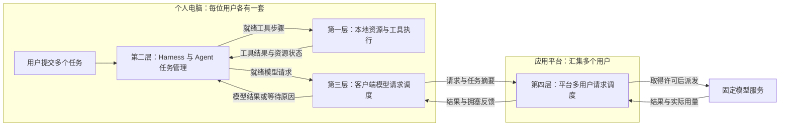

# TaskLoom「织序」项目说明书

面向 Agent 多任务的个人端与平台协同调度系统。

**项目概念：**TaskLoom 在个人电脑上协调多个 Agent 任务的工具执行与模型请求，在平台上安排多个用户的请求，让有限资源支持更多及时、合格完成的任务。

**文档用途：**用于理解项目、讨论开题与介绍方案。**版本：**v1.1，2026年9月29日；补充工具选择、死锁控制与银行家算法的阶段化应用。

本文从实际使用中的问题出发，依次说明项目要解决什么、系统如何组成、各层怎样工作，以及如何验证效果。文中系统能力均为拟实现内容；文献发现、社区报告和本项目的研究假设分别说明。

**当前版本入口（2026-10-15）** 完整项目内容以[当前完整方案](TaskLoom_项目说明书_当前完整方案.md)为主要入口；[开发路线与 OpenClaw 对照方案](TaskLoom_开发路线与OpenClaw对照方案.md)解释自研与对照取舍。本文保留前版分层设计，两个场景和四层模型继续适用。

## 1. 痛点与目标：为什么需要 TaskLoom

项目面对两个明确的场景：**一个人在自己的电脑上同时运行多个 Agent 任务；一个平台同时接收多个用户的模型请求。**两处都要决定有限资源先给谁使用，但能够看到的信息不同。

### 1.1 从一个具体的使用场景开始

假设一名学生同时让 Agent 完成三项工作。以下是用于设计和实验的示例，并非对真实用户任务比例的统计。

| 用户交给 Agent 的任务 | 执行中可能发生的工作 | 用户主要关心什么 |
| :--- | :--- | :--- |
| 整理一批课程资料 | 请求模型制定处理步骤，调用程序解析文档，再请求模型汇总。 | 能持续推进，最终交付完整结果。 |
| 修改并测试代码 | 请求模型分析代码，修改文件，启动测试，依据测试结果继续处理。 | 修改和测试顺序正确，失败后可以继续。 |
| 临时解释一个概念 | 发起一次或少量模型请求。 | 尽快获得回答。 |

**在个人电脑上，三项任务可能相互影响。**资料处理和代码测试会争用 CPU、内存或磁盘；它们产生的模型请求，又可能与临时问答争用同一份 API 额度。

**在平台上，这名学生还只是许多用户中的一个。**如果平台的总额度或允许同时派发的请求数有限，就必须在不同用户之间分配服务机会。

因此，TaskLoom 研究的对象是这些任务的执行安排。模型能力保持不变，改进空间来自减少可避免的等待、失衡和异常损耗。

### 1.2 调研发现了哪些具体问题

按照问题发生的位置，可以把现有发现分为四类。这四类也将对应后文的四层设计。

#### 1.2.1 本地资源：允许并发，不代表电脑承受得住

两个工具都可以独立执行，并不意味着它们适合同时启动。例如，两个文档解析进程分别运行没有问题，同时运行却可能使内存紧张；一个测试命令还可能在内部启动很多子进程。

**根因是工具的资源需求不同，而简单的“最多同时运行几个”不能完整描述这些差异。**PeakBench 将依赖是否允许并行与资源容量是否允许并行分开评估，为这个问题提供了方法依据，但其容量评估不能直接当作普通个人电脑上的事故统计。[S03]

另一个需要验证的设计问题是：几个工具各自拿到一部分资源后，是否可能互相等待剩余资源。此时，“眼下还有空闲名额”不等于“分出去后仍能顺利结束”；需要额外考虑分配后的安全状态。

另一类问题发生在工作结束之后。Codex 的公开问题单报告过特定退出路径没有完成后代进程清理，也报告过特定 Git LFS 场景下临时文件大量占用磁盘。这说明资源管理还需要覆盖退出与产物回收，不能只控制启动数量。[S12][S14]

#### 1.2.2 Harness：任务结束、结果交付和资源释放可能脱节

Harness 是让 Agent 实际运行起来的软件：它保存任务状态，调用模型，执行工具，并把结果交回 Agent。模型提出“下一步调用工具”，真正发起调用的是 Harness。

一个步骤已经完成，不代表整个任务已经正确结束。父任务可能仍在等待子任务通知，结果可能尚未保存，相关进程也可能仍在收尾。

**根因是不同组件对“完成”的理解不一致，或者完成、失败、取消之间缺少可靠交接。**DeepSeek Harness 的社区讨论描述过失败消息留下所有权依赖，导致工作完成却无法结算的情况；其源码静态分析支持这一问题链，但本项目尚未独立复现。[S13]

控制消息也可能被普通输出拖慢。有关后台事件流影响前台响应的报告提示我们：停止、取消和完成通知，需要及时传递，不能无限排在日志或流式输出之后。[S15]

#### 1.2.3 客户端模型请求：各任务分别重试，可能共同挤占额度

同一用户的多个 Agent 任务，可能共用账号、项目或端点的请求限额。一个任务产生多个子 Agent 后，还可能在短时间内集中发出请求。

**根因是每个调用只知道“我想继续”，却未必知道其他任务已经使用了多少额度、谁更紧急，以及什么时候适合再次尝试。**已有社区报告涉及 `Retry-After` 等待提示没有正确传递、内部重试时限与外层任务等待时限不一致等问题。[S19]

费用控制还存在另一种取舍：预留过多，会让实际仍够用的预算暂时无法使用；预留过少，又可能在多个请求同时执行时超出预算。这需要明确计账规则，不能只靠调整请求优先级解决。[S07]

#### 1.2.4 平台请求：看到了单次调用，不等于理解了完整任务

平台可以知道是谁发来的请求、请求有多大、已经等了多久，但通常不能仅凭这些信息，可靠判断它属于哪个完整任务、是否正在等待本地工具，以及用户还有哪些任务在竞争。

**这里的研究问题是：按完整任务组织请求，是否比只管理单个请求更有利于用户完成工作。**例如，一个复杂任务拆出许多子 Agent 后，不应仅凭请求数量多，就获得不成比例的服务机会。

这项问题具有明确的机制依据，但目前的材料不足以证明所有平台都严重失衡。HiveMind、Temporal 和 LiteLLM 已经提供优先级、公平、限流或依赖管理等能力；TaskLoom 必须验证在这些合理措施之后，任务信息与端侧状态是否仍能带来改善。[S06–S08]

### 1.3 现有方案解决到了哪里

项目的出发点是完善任务之间、阶段之间的协调。AIOS 已经研究了 Agent 调度和工具管理，因此“给 Agent 加一个调度器”本身不是新的贡献。[S04] 现有能力及其剩余空间可以概括如下。

| 问题位置 | 已有的主要办法 | 本项目需要继续验证的部分 |
| :--- | :--- | :--- |
| 本地资源 | 并发上限、资源声明、操作系统隔离和进程清理。 | 混合工具需求、临时产物和不同退出路径能否统一管理。 |
| Harness | 任务依赖、子 Agent 管理、检查点和恢复。 | 等待、唤醒、取消、结果保存与实际资源释放能否衔接正确。 |
| 客户端请求 | 限速、退避重试、费用预算和请求优先级。 | 多任务共用额度时，分配、等待和续作能否围绕完整任务协调。 |
| 平台请求 | 用户配额、公平队列、优先级和过载保护。 | 加入任务归属与必要的端侧反馈后，是否还有可测量的收益。 |

**优先级最高的是会阻断任务或留下实际资源占用的问题。**这类问题已有具体案例，可以转化为可复现的故障测试；严重程度仍取决于版本与触发条件。

**其次是资源紧张时的效率与公平问题。**这些问题适合通过负载实验验证，不能因为提出了一个新排序规则，就认定它一定优于已有方案。

已修复的缺陷、可以通过正确配置解决的问题，以及尚未明确根因的投诉，都不会被写成普遍存在的研究空白。

### 1.4 TaskLoom 希望改善什么

项目的总体目标是：**在相同模型、相同资源与额度、相同任务质量要求下，让更多任务及时完成，并让失败、取消和恢复过程更可控。**

这个目标分为四项可以观察的结果。

- **交互任务少等待。**临时问答或紧迫任务可以较快获得执行机会，同时避免后台任务长期停滞。

- **本地工具少互相拖慢。**按照实际需求控制启动，减少过度并发造成的内存压力、执行变慢和失败。

- **有限额度得到有效使用。**减少不合适的重试、重复工作和无用等待，让已有预算支持更多合格结果。

- **任务结束有明确交代。**已经完成的成果能够交付，取消的工作能够收敛，仍不确定的结果能够被明确标记。

这些是待验证的改善方向。调度不会增加服务商的硬额度，也不会直接缩短模型完成同样推理所需的计算时间。

---

## 2. 总体设计：两个场景，四个层次

TaskLoom 分成**个人端**和**平台端**。个人端包含本地资源层、任务管理层和客户端请求层；平台端包含多用户请求调度层。四层按职责协作，不要求每层都部署成独立服务。

### 2.1 两个场景分别管什么

#### 2.1.1 个人端：安排自己的多个任务

个人端运行在用户自己的电脑上，管理受控 Agent 任务及它们启动的工具。它能够看到任务目标、已知依赖、本地资源和待发送模型请求。

其核心问题是：**自己的哪项工作现在应该推进，推进时能使用哪些资源。**其他用户不会直接参与这台个人电脑的本地工具调度。

#### 2.1.2 平台端：安排多个用户提交的请求

平台端是本项目能够控制的应用 API 入口。多个个人端向它提交模型请求，由它在固定的总额度和在途请求上限内安排派发，再调用既有模型服务。

其核心问题是：**现在的服务机会应该分给哪个用户，以及该用户的哪个任务。**它不修改模型内部执行过程，也不接管模型服务商的 GPU 调度。

#### 2.1.3 单机与协同模式如何对应

个人端可以单独工作，直接调用模型服务。此时，本地请求管理器负责自己独占使用的 API 额度规则。

多个个人端通过 TaskLoom 平台共用一份上游额度时，平台负责这份共享额度的最终分配。个人端安排自身任务与发送节奏，不能各自把同一份全局额度当成独立额度再分配一次。

### 2.2 四层如何组成完整架构

下表从底层资源逐级向上，给出四层的完整职责。**第二层决定步骤是否已经就绪，第一层和第三层分别安排工具与模型请求，第四层再协调不同用户。**

| 层次 | 所在位置 | 管理对象 | 这一层回答的问题 |
| :--- | :--- | :--- | :--- |
| 第一层：本地资源与工具执行 | 个人电脑 | 工具进程、CPU、内存、文件及临时产物。 | 这个工具现在能否启动，占用怎样限制，结束后怎样回收？ |
| 第二层：Harness 与 Agent 任务管理 | 个人电脑 | 用户任务、子 Agent、步骤依赖和执行状态。 | 任务现在进行到哪里，下一步做什么，需要等待谁？ |
| 第三层：客户端模型请求调度 | 个人电脑 | 已就绪的模型请求、个人任务预算和重试。 | 自己的哪个请求先发，现在是否允许发送？ |
| 第四层：平台多用户请求调度 | 应用平台 | 多用户请求队列、共享额度和派发机会。 | 哪个用户先得到服务，一个用户内部又该服务哪个任务？ |

下面的图表示调用路径。工具执行和模型请求是两条分支，并不是所有工作都必须逐层经过四层。

守护、记录和可视化是四层共用的支撑能力。它们观察和保护上述执行过程，不再被拆成新的业务调度层。

### 2.3 一项 Agent 任务怎样在系统中运行

#### 2.3.1 用户任务是分配资源的基本单位

用户提交的“整理课程资料”是一项任务。模型调用、文档解析和子 Agent 的工作，都是为这个原始目标服务的步骤。

系统记录这些步骤属于哪个用户任务，使资源使用和最终结果可以归到同一个目标下。后文的“根任务”就是这个原始用户任务。

#### 2.3.2 一个步骤可能调用模型，也可能执行工具

需要模型理解、规划或总结时，Harness 产生一个模型请求，交给第三层排队。需要解析文件、计算或测试时，Harness 把工具步骤交给第一层。

工具执行本身通常不需要模型 API。工具完成后，是否再次请求模型，由当前任务流程决定；工具内部另行调用模型的情况，需要显式接入同一个请求入口才能统一管理。[S10]

#### 2.3.3 子 Agent 是任务的分支

当一个任务被拆成多个子 Agent 时，它们可以分别推进自己的步骤，但仍归属于同一个原始任务。派生关系不会自动创造更多账号额度或更高的平台份额。

Agent 是逻辑上的执行者，不必与操作系统进程一一对应。真正调用解析器、测试程序等工具时，才按需要启动和管理相应进程。

#### 2.3.4 工作流会随着执行逐步展开

系统不要求提前知道一项任务的全部步骤。它只安排当前已经明确、依赖已经满足的工作，模型或工具产生新结果后，再更新下一步。

例如，只有测试结果出来后，Agent 才知道是否需要修复代码。调度器可以估计后续工作，但不能把估计当作已经确定的依赖。

对需要分批取得资源的受控工具，再划分“执行阶段”：从开始申请资源，到能够独立结束并归还本阶段资源的一段工作。银行家算法只检查满足上限声明条件的阶段，不要求提前知道完整 Agent 任务的所有未来步骤。

### 2.4 四层依靠什么信息协作

四层不必共享全部内部细节，只需要交换能影响当前决策的信息。信息分为四组。

| 信息组 | 具体内容 | 使用目的 |
| :--- | :--- | :--- |
| 任务归属 | 用户、原始任务、子任务及当前步骤。 | 防止子 Agent 扇出后重复获得份额，便于汇总结果与用量。 |
| 执行状态 | 已就绪、正在运行、等待工具、等待额度、已取消。 | 让各层知道哪些工作可以继续，哪些结果已经不再需要。 |
| 资源与目标 | 当前资源占用、请求规模、预算、用户设定的紧迫程度。 | 判断能否启动，以及在可执行工作中先安排谁。 |
| 完成与反馈 | 工具结果、模型用量、资源释放、平台拥塞提示。 | 触发下一步、结算实际消耗，并调整后续发送节奏。 |

这些信息由运行时记录和测量。平台不需要额外调用一个模型来“猜用户有多着急”，也不需要获得用户本地的完整文件内容。

---

## 3. 分层方案：每一层具体解决什么

四层使用同一条工作主线：**确定当前可做的步骤，检查资源是否允许，再安排执行顺序，最后确认结果和资源归还。**下面按层介绍具体方法。

### 3.1 第一层：本地资源与工具执行

这一层负责工具在个人电脑上的实际运行。它不替 Agent 决定业务目标，而是保证已被选中的工具以设备能够承受的方式执行。

#### 3.1.1 启动管理：确定先启动谁，再检查怎样分配资源

**要解决的问题：**只限制工具数量，无法区分轻量检索和高内存解析，也无法覆盖工具自身的多线程或子进程。

**拟采用的方法：**使用资源约束的列表调度，从已就绪工具中挑选工作；资源申请由统一管理器检查。挑选顺序与分配安全分别处理，不能用高优先级绕过资源约束。

具体规则分成四项。

1. **就绪工具选择。**先按原始任务轮转，再在其可用机会内参考紧迫程度与等待时间。当前资源不够的工具可以暂时跳过，让其他可执行工作推进。

2. **大工具等待保护。**记录等待时间与被跳过次数；合法的大工具反复被跳过时，暂缓接纳占用同类资源的新工作，等待现有占用释放。该限制不阻止已准入阶段取得完成所需的安全分配，否则可能反过来卡住资源归还。它可能牺牲一些短期吞吐，需要与最长等待一起评价；超过设备总容量的工具应明确拒绝。

3. **一次性申请模式。**需求已明确的工具，对本步骤所需槽位、内存预算和临时空间一起检查、一起预留。任何一项不满足就不留下部分预留；这称为原子准入，适合作为首版基础策略。

4. **分批申请模式。**受控阶段确实需要边执行边申请工具实例时，先声明最大需求，再由银行家安全检查逐次决定是否批准。同一资源管理域中的两种模式共用实际占用账本，避免各自认为资源仍然空闲；具体规则见3.2.2。

这里使用**列表调度、Aging、信号量和原子资源分配**。资源检查和账本修改处于短临界区，网络和工具执行放在临界区之外；同一工具实例的初始化也使用互斥，避免并发创建后只留下一个可管理的记录。

#### 3.1.2 共享访问：保护会互相影响的操作

**要解决的问题：**两个步骤即使都有执行资源，也可能同时修改同一文件，或者一个修改代码、另一个过早运行测试。

**拟采用的方法：**对已声明的共享对象使用互斥锁或读写锁；有业务先后关系的步骤由第二层维护依赖。共享访问进一步分成三项规则。

1. **固定申请顺序。**需要多个锁时，按统一的资源顺序取得，防止任务A拿着一个锁等任务B、任务B又拿着另一个锁等任务A。无法满足该顺序的工具必须调整执行阶段或使用另行验证的协议。[S22]

2. **条件性优先级继承。**紧急任务被低优先级任务持有的锁阻塞时，暂时提高持锁者相关就绪步骤的执行优先级，帮助它尽快释放锁。提升不改变资源上限和费用预算，也不解决真正的循环等待；只有明确锁拥有者且能影响其执行时才启用。[S23]

3. **限定可管理范围。**独立文件的只读操作可以并行，同一工作区的修改和测试遵循依赖。任意 shell 的读写范围难以准确判断，首版使用受控工具或保守独占；Python的普通锁不会因为我们记录了优先级就自动具备内核级优先级继承。

资源实例的数量由资源管理器检查，文件或工作区的锁按访问协议管理。不同机制需要衔接，不能把未计入的外部锁留在一边，却宣称银行家检查已经消除了全部死锁。

#### 3.1.3 存量管理：限制临时文件与工具输出

**要解决的问题：**并发数已经下降后，临时副本、浏览器会话和大段输出仍可能占用内存、磁盘或连接资源。[S14]

**拟采用的方法：**给任务设置产物空间上限，记录哪些结果仍被使用，并在任务结束后回收不再需要的临时内容。大输出保存为文件，消息中传递文件位置和必要摘要，避免全部堆在内存队列中。

这里使用**配额、引用计数与到期回收**。仍被后续步骤使用的结果必须保留；空间不足时明确等待或报错，不能静默删掉必要内容后声称任务质量不变。

#### 3.1.4 执行保护：管住工具启动的整个进程树

**要解决的问题：**工具可能启动后代进程；主程序退出或界面显示取消，不代表这些后代已经停止。[S12]

**拟采用的方法：**首版在 Linux 环境中使用进程组和 cgroup v2，记录本系统启动的工具树，限制其资源使用，并在超时或取消时完成受控清理。cgroup 的硬限制用于防止影响扩大，不保证超限任务仍能成功。[S11]

独立守护进程负责检查执行器是否存活、后代是否退出，以及实际占用是否已经归还。它只管理 TaskLoom 拥有的资源，不能按模糊进程名清理用户整台电脑。

### 3.2 第二层：Harness 与 Agent 任务管理

这一层负责完整任务如何推进。**模型提出下一步工作，TaskLoom 的运行时决定何时允许它真正执行，并记录执行结果。**

#### 3.2.1 依赖管理：只启动已经就绪的工作

**要解决的问题：**过早启动会读到不完整结果，过度串行又会浪费可以并行的机会。

**拟采用的方法：**维护当前已知步骤之间的依赖。互不依赖的文档解析可以成为多个就绪步骤；“修改代码后测试”保留先后顺序；需要汇总多个子 Agent 结果时，等待必要结果齐备再继续。

这里使用**任务依赖图、生产者—消费者和同步屏障**。LLMCompiler 已证明依赖感知的函数编排是已有研究方向，TaskLoom 将在此基础上增加本地资源和请求额度约束。[S05]

#### 3.2.2 等待与死锁控制：对受控阶段应用银行家安全检查

**要解决的问题：**任务分批取得资源时，仅检查当前空闲量可能留下循环等待。父 Agent 占着子 Agent 必需的执行槽并等待子 Agent，也是需要防止的等待模式。

**银行家算法可以用于动态任务。**关键前提是当前纳入管理的工作能够声明最大资源需求，所有相关申请受到控制，并在获得所需资源后能够结束并归还。新任务不断到达不等于算法不能使用；难点在于需求上限能否成立、变化能否被正确处理。[S21–S22]

TaskLoom 拟采用以下四项规则。

1. **按可结束的阶段声明上限。**由受控工具模板声明从当前阶段开始到释放资源前最多需要多少实例；阶段就绪时动态登记。首版只对能够拦截每次申请的工具实例、浏览器实例等可归还名额验证，内存仍由预算和cgroup保护。均值、P95或模型猜测不能直接当作保证安全的最大值。

2. **每次分配前检查安全状态。**记录现有空闲量、各阶段已占用量和最大需求，先试算批准本次请求后的状态。若能找到一个顺序，使各阶段在各自上限内依次完成并归还资源，才批准；找不到时暂缓。安全检查是放行条件，具体由谁先获得机会仍由公平调度决定。

3. **需求改变时重新核验。**新增阶段、提高需求上限或调整管理容量，都先检查再生效。扩展被拒后，只有仍能按原上限结束的阶段可以继续原计划；若原上限已经不足，必须在确认能够安全停止并释放资源后重新申请。不能只把最大值改大，也不能拿着资源无限等待一个已无法满足的旧计划。

4. **等待不虚假释放资源。**父任务等待子任务时，释放已经不再使用的执行许可；仍驻留的对象继续记账。首版不允许受检阶段持有本域资源，等待一个未被纳入需求、且必须依赖这些资源的子阶段；需要拆分阶段。完成、额度恢复或资源归还后通过事件唤醒，并重新检查就绪条件。

一个简化例子能说明检查的作用：总共有3个可归还名额，A最多需要3个，B最多需要2个；两者已经各占1个，只剩1个。若再给A，A和B仍可能各差1个，系统进入不安全状态；若给B，B可以结束并归还，再让A完成。**不安全状态不等于已经死锁，而是按声明上限不能再保证存在安全完成顺序。**

这一设计称为**银行家安全检查的阶段化应用**。它不是对任意Agent行为的全局无死锁保证，也不直接管理API速率、已消耗费用或模型GPU。若工具原本就能一次取得全部资源、执行后全部释放，银行家检查可能没有额外收益，应与更简单的原子准入比较。

算法定义、动态上限处理和改进实验见[OS算法补充说明](E:/Project/OS-Project/docs/TaskLoom_OS算法补充说明.md)。主系统保持四层，不为银行家算法增加新的业务层。

#### 3.2.3 进度管理：保存已确认完成的工作

**要解决的问题：**模型额度暂时不足或程序异常后，用户可能看不清哪些步骤完成了、哪些成果能够继续使用。

**拟采用的方法：**保存步骤状态、结果位置和必要的续作信息。恢复时先核验输入和结果是否仍有效，再从可以继续的位置推进，避免无关步骤失败后全部重做。

这里使用**检查点、日志与文件持久化**，并参考 LangGraph 已有的恢复能力。[S09] 对话摘要用于帮助模型继续理解任务；“哪个步骤完成、资源归谁”另行保存，不能只依赖可能被压缩的聊天历史。

#### 3.2.4 结束管理：让取消、结果提交和清理衔接起来

**要解决的问题：**父任务取消后子任务可能还在运行；旧的一次执行可能迟到返回；辅助日志上传也可能拖住退出。[S13][S16]

**拟采用的方法：**沿父子关系传递取消，分别确认结果是否可交付、工具是否停止、费用是否结清。重试后的新执行使用新的编号，防止旧结果覆盖新结果或同一资源被释放两次。

完成和取消通知使用独立于普通输出的控制通道，并通过状态记录核对。这运用了**进程通信、结构化并发和幂等提交**；对无法确认的外部操作，保留“结果待核实”，而不是直接判定未执行并重做。

### 3.3 第三层：客户端模型请求调度

这一层统一管理一个用户的待发送模型请求。它安排的是“自己的哪个请求先发”，不能决定远端模型内部如何计算。

#### 3.3.1 统一入口：先把各任务的调用放到一起管理

**要解决的问题：**如果每个 Agent 各自发送和重试，就无法准确观察它们共同占用了多少请求机会。

**拟采用的方法：**让受控 Agent 的模型调用先进入统一入口，带上所属任务和当前步骤。请求只有在前置工具结果已经准备好时，才进入就绪队列。

任务规划、工具结果分析、子 Agent 的模型决策和最终总结，都可能产生模型请求。没有调用模型的本地解析或计算，不进入这个队列。

#### 3.3.2 额度管理：分清哪些会恢复，哪些已被消耗

不同限制需要不同的处理规则。系统至少分清以下四项，并以实际服务商文档为准。[S18]

| 限制 | 含义 | 应怎样处理 |
| :--- | :--- | :--- |
| 请求速率 | 一段时间内允许发出多少次请求。 | 按窗口或补充规则等待可用机会。 |
| Token 速率 | 一段时间内允许处理多少输入或输出。 | 按具体规则估计和记录，不能只数请求次数。 |
| 在途数量 | 同时已有多少请求发出但尚未结束。 | 控制占用，确认请求结束后归还名额。 |
| 总预算 | 一项任务或一个用户最多可花多少费用。 | 派发前预留，返回后结算；已消费的费用不会自动恢复。 |

可采用**令牌桶或窗口计数、计数信号量与原子账本更新**。这里的关键不是统一套用一种算法，而是让每一种限制都按真实规则计算。

对于严格费用上限，预留必须覆盖可强制执行的单次费用上界。只有能够明确计量风险时，才把更灵活的估计预留作为实验方案。

#### 3.3.3 顺序管理：兼顾紧急任务与持续推进

**要解决的问题：**一个产生大量请求的任务可能占去多数机会，短时交互任务排在后面；若始终优先交互任务，后台任务又可能一直得不到服务。

**拟采用的方法：**先按原始用户任务分组轮转，再在允许的份额内参考紧迫程度和等待时间。子 Agent 继承所属任务的份额，不能靠多开分支取得更多机会。

基础策略使用**成本 DRR、公平轮转和 Aging（等待老化）**。DRR 为各任务逐轮积累可用服务份额，并按估计请求成本扣减；Aging 让等待较久的任务逐渐获得机会。对用户明确给出截止时间的任务，可借用 **EDF** 的期限排序思想，但不承诺所有期限都能满足。[S20]

成本使用可观测的输入、预测输出等信息，并在返回后按实际用量修正。不能简单认定“问答一定短、资料任务一定长”，也不能把这里的成本当作真实 GPU 占用。

#### 3.3.4 重试管理：在有条件成功的时候再尝试

**要解决的问题：**所有任务在同一时刻重试，可能再次触发限制；没有额度时持续尝试，只会增加等待和错误。

**拟采用的方法：**临时限速时优先遵循服务端等待提示，再结合退避和随机错开时间；总预算耗尽时明确暂停或结束；遇到不确定的网络失败时，先判断能否安全重试。

这里使用**延迟队列、指数退避和重试总时限**。排队等待不占用不再需要的执行槽；请求已经发送却未确认结果时，不能假设远端没有执行，也不能直接退回全部费用预留。[S19]

### 3.4 第四层：平台多用户请求调度

这一层接收多个用户的请求。它与第三层使用相近的调度思想，但公平分配的范围从“一个人的多个任务”扩大到“多个用户及其任务”。

#### 3.4.1 信息管理：平台依靠什么判断顺序

**要解决的问题：**完整对话上下文也不一定告诉平台任务期限、子任务归属或本地工具是否忙碌。部分 API 可以关联会话，但会话关联仍不等于任务调度信息。[S10]

**拟采用的方法：**在请求旁附带少量明确字段，包括任务归属、服务类别、请求规模以及必要的本地状态。用户身份由平台认证，任务关系由运行时记录；未知的后续工作明确标为未知。

平台按策略限制“紧急”类别的使用，防止所有请求都自报最高优先级。商业模型服务不支持这些字段时，由自建平台保存并使用，转发给模型的仍是原有 API 请求。

#### 3.4.2 公平管理：先分用户，再分用户内部任务

**要解决的问题：**只有全局先来先服务，难以表达用户份额；只按请求数平均分，又会忽略请求成本和一个任务拆出大量分支的情况。

**拟采用的方法：**平台先在用户之间分配份额，再在用户内部按原始任务轮转。请求成本参与记账，紧迫程度和等待时间用于份额范围内的次级排序。

这里使用**分层加权公平与成本 DRR**。用户暂时没有工作时，其空闲机会可以被其他用户利用；优先级主要影响尚未派发的请求，不假设已经开始的远端模型调用可以无损抢占。

#### 3.4.3 接纳管理：工作已经太多时，明确反馈压力

**要解决的问题：**如果平台不断接收新请求，队列可能越来越长，用户只看到持续等待，却不知道什么时候能够开始。

**拟采用的方法：**同时限制等待队列和在途请求。可以接纳的请求进入队列；无法合理接纳的请求返回明确的忙碌或稍后重试信息，不无限积压。

这里使用**有界队列、准入控制与背压**。平台接纳排队不等于模型已经执行，取消尚未派发的请求也不应被当作一次完整模型消费。

#### 3.4.4 协同管理：让个人端与平台互相告知必要状态

**要解决的问题：**平台不知道客户端后续工具已经堆积，客户端也不知道平台当前队列压力。两边各自调节，可能出现重复排队或限制过度。

**拟采用的方法：**平台反馈建议发送窗口和有效期；个人端反馈与当前请求相关的本地压力。已知某类模型请求会继续制造大量拥塞工具工作时，可以暂缓这一类请求，仍允许无关问答继续。

反馈采用**背压、平滑调整和过期回退**。信息缺失时，两边依然可以独立运行；未知后续步骤不提前占住资源，也不因一个工具繁忙而停止所有模型请求。

协同是否值得，是本项目需要实验回答的问题。只有它优于“个人端和平台各自已经优化好、但不交换动态反馈”的方案，才能证明增加信息交换有实际价值。

---

## 4. 项目落地：怎样展示、验证和完成

最终交付是一套能够运行和观察的调度原型。它应让人看到任务如何推进、在哪里等待、异常后如何处理，并用相同条件的对照实验说明效果。

### 4.1 用一条任务过程串起四层

仍使用前面的资料整理、代码测试和临时问答场景。演示按照四个阶段展开，每一步都能够在事件记录中核对。

1. **任务进入系统。**第二层分别建立三个用户任务，识别当前已就绪的模型请求或工具步骤。此时还没有发生的后续工作不提前排队。

2. **个人端安排执行。**第一层判断解析和测试能否同时运行；第三层在额度允许的条件下安排问答及其他模型请求。紧急工作获得适度优先，后台工作保留推进机会。

3. **平台协调多个用户。**第四层将这名用户与其他用户一起纳入公平调度。模型返回后，结果交回相应任务，第二层再决定是否启动工具、子 Agent 或下一次模型请求。

4. **任务完成或发生异常。**结果通过任务验收后交付；若中途取消或失败，第二层协调停止与续作，第一层确认本地资源回收，请求层确认剩余额度和实际费用。

演示中的改善应来自真实调度行为。界面中的状态变化必须对应实际队列、进程和调用记录。

### 4.2 系统最终有哪些可见功能

面向用户与老师的界面分成四个视图。每个视图解释一种信息，避免把全部技术指标堆在一个页面。

| 视图 | 显示内容 | 能回答的问题 |
| :--- | :--- | :--- |
| 任务视图 | 用户任务、子任务、已完成步骤与当前等待原因。 | 我的任务现在进行到哪一步？ |
| 本地资源视图 | 运行中的工具、主要资源占用和待启动工作。 | 哪个工具正在占用资源，为什么另一个还不能运行？ |
| 请求与额度视图 | 待发送、平台排队、在途请求及预算使用。 | 请求在哪一段等待，额度还剩多少？ |
| 对照与恢复视图 | 策略切换、指标变化、取消与恢复过程。 | 新方案是否改善结果，出错后是否恢复正确？ |

首版接入一个可修改的 Agent 运行时，通过模型调用和工具执行前后的接口介入。LangChain 中间件及 DeepSeek Harness 的相关接口提供了接入依据，但仍需验证具体版本。[S17]

仅设置一个 API 代理无法看见全部本地工具。因此，工具执行和任务状态必须同时接入，首版不承诺透明接管所有现成 Harness。

### 4.3 怎样证明项目有效

#### 4.3.1 实验条件：保持工作与资源可以比较

各组使用相同的模型配置、任务集合、额度和设备资源，并采用同样的结果验收标准。改变的是调度方式，不能用减少必要步骤或放宽答案质量获得优势。

负载分别覆盖资源宽松、仅模型请求受限、仅本地工具受限、两边同时受限四种情况。工具使用真实程序测量；模型阶段可以先采用受控回放隔离调度变量，再用小规模真实调用验证。

TraceLab 等公开追踪可以帮助校准任务和工具时长分布，但不能替代本机 CPU、内存与并发干扰测量。[S01] 如果真实任务主要等待模型、工具没有竞争，也应保留这一结果。[S02]

#### 4.3.2 对照方案：把各部分的贡献分开

所有方案都应具备合理的限流、重试、取消清理和基本恢复能力。对照分成以下五组，防止把基础功能缺失造成的差距当成新调度算法的收益。

| 对照组 | 个人端 | 平台端 | 用来判断什么 |
| :--- | :--- | :--- | :--- |
| 基础方案 | 合理配置的工具并发与 API 控制。 | 合理的公平队列及过载保护。 | 成熟简单方案已经能做到什么。 |
| 只优化个人端 | 加入任务、资源和额度协调。 | 保持基础方案。 | 个人端改进是否有效。 |
| 只优化平台端 | 保持基础方案。 | 加入任务级请求调度。 | 平台端改进是否有效。 |
| 两端分别优化 | 启用个人端改进。 | 启用平台端改进。 | 两个独立改进共同运行的效果。 |
| 两端协同优化 | 在上一组基础上交换动态压力信息。 | 在上一组基础上反馈拥塞信息。 | 协同信息本身是否有额外收益。 |

最后两组保留相同的任务身份、静态声明和调度算法，只切换动态反馈。可靠性机制另做故障对照，不把修复进程残留产生的收益全部归入请求排序。

新增OS机制还需独立比较，避免把所有收益混在一起。

- **工具选择实验：**对比严格队首执行、允许可行工具先行、加入老化与大工具等待保护，测利用率和最长等待的变化。

- **资源分配实验：**对比一次性全量原子申请、按固定阶段上限执行的银行家检查、带安全检查的阶段边界更新。最后一项使用相同工具语义和资源上限依据，不靠更准确的预测占优势；故意不做安全控制的策略只用于受控死锁演示。

- **优先级反转实验：**在确有持锁者等待执行机会的受控场景中，对比是否启用优先级继承；同时报告对其他任务的影响。仅修改界面优先级不算完成实现。

- **异常边界实验：**注入新阶段到达、上限增加被拒、超过原声明需求和取消后资源尚未释放等事件，检查账本、暂停与清理是否符合规则；不把拒绝一个不安全请求记成任务已经成功恢复。

#### 4.3.3 评价指标：以完整任务结果为中心

主要指标是**按时、合格完成的任务比例**。对于有期限的同一批任务，统计在期限前通过验收的数量；拒绝和未完成任务不能从提交分母中悄悄消失，尚未到期限的任务继续观察或单列待定。

辅助指标分为四类。

- **等待体验：**交互任务的中位数和 P95 完成时间。P95 用来观察较慢的一部分任务，避免平均值掩盖明显卡顿。

- **公平程度：**后台任务最长等待、相对独占执行的变慢程度，以及不同用户得到的服务份额。

- **资源与额度：**工具失败率、实际费用、无效重试和调度自身开销。尚未结算的费用单独记录，不当作已经节省。

- **恢复质量：**取消后仍存活的自有进程、资源回收时间，以及能够安全续作或明确报告未知结果的比例。

没有截止时间的后台任务，单独比较合格完成数量与完成时长。任务质量由既定测试、答案字段或资料覆盖要求检查，不能只以 Agent 自报完成为准。

#### 4.3.4 长期展示：模拟一个月后的变化

在真实测量校准后，进行 30 天离散事件仿真，展示每日任务完成、等待、费用和异常残留的变化。仿真同时保留任务依赖、工具容量和额度恢复规则，不能只把请求到达加快来制造拥塞。

长期演示报告哪些结果来自实测、哪些来自模拟。先导实验之后确定正式目标，不预先承诺没有数据支撑的提升比例。

### 4.4 开发怎样推进，项目价值在哪里

#### 4.4.1 分阶段实现

开发以能运行的任务闭环为起点，再逐步增加调度和协同能力。课程阶段安排如下。

| 阶段 | 主要工作 | 可检查的成果 |
| :--- | :--- | :--- |
| 第1至2周：确认场景 | 接通运行时、受控工具和模型入口，测量实际竞争。 | 可运行样例、工具需求记录和额度规则。 |
| 第3周：完成开题 | 固定四层职责、任务流程和实验方法。 | 最小串通原型与完整方案说明。 |
| 第4至6周：实现与展示 | 先完成两端独立能力，再接入协同反馈和故障恢复。 | 调度原型、对照数据与小组演示。 |
| 第7至8周：复核与答辩 | 完成长期仿真、结果分析及个人材料。 | 可复查的文档、配置和实验记录。 |

#### 4.4.2 小组分工

团队按四个工作包分工：任务与 Harness 接入、本地执行与恢复、请求与平台调度、实验与界面。每个工作包都有明确接口，并由另一工作包交叉检查。

四至六人的小组可以在这些工作包内增援，而不是为了分工额外增加系统层次。首版使用 Python、异步网络调用、独立工具进程和轻量数据库即可，不以搭建复杂分布式集群为前提。

#### 4.4.3 OS 知识如何形成实际价值

本项目把 OS 方法用于真实的管理对象：调度算法安排任务机会，信号量控制有限容量，锁保护共享访问，事件与进程通信推进依赖，进程组和守护机制负责隔离与回收，日志和检查点支持续作。

新增机制各自处理不同的问题：列表调度选择就绪工具，原子准入与锁顺序用于基础死锁预防，银行家检查在声明上限成立时避免不安全分配，优先级继承在适用场景中减少锁引起的优先级反转。银行家算法并不代替公平排序，也不直接解决所有长时间等待。[S21–S23]

这些机制共同服务于一件事：让 Agent 多任务执行具有可解释的顺序和可核对的结果。它们不是为了凑齐课程术语而设置的独立展示功能。

#### 4.4.4 预期贡献

TaskLoom 的候选贡献是把**用户任务、工具资源和模型请求放到同一条执行主线上**，并在个人端与平台端之间交换必要信息，检验是否能够改善完整任务交付。

公平队列、限流和检查点都有成熟先例。项目的说服力来自具体场景中的组合设计、清楚的控制边界和严格对照；如果协同没有额外收益，也应据实说明哪一层已经足够有效。

---

## 5. 参考来源与证据边界

本版使用仓库已有调研及附加报告的核验结果，没有把已有问题单重新统计成新的事故样本。材料核验截至2026年9月29日，社区报告的当前适用性仍需在实现阶段复测。

### 5.1 工作负载与 Agent 编排研究

这些研究支持任务阶段差异、工具资源约束和依赖编排的分析。其原文实验条件不直接等于 TaskLoom 的预期收益。

| 编号 | 来源 | 本文使用的范围 |
| :--- | :--- | :--- |
| S01 | [TraceLab: Characterizing Coding Agent Workloads for LLM Serving](https://arxiv.org/abs/2606.30560v2) | 编码 Agent 工作负载与工具时长分布；不提供本机资源竞争的直接证明。 |
| S02 | [Agentic Coding in the Wild: Characterizing GitHub Copilot at Production Scale](https://arxiv.org/abs/2608.00101) | 模型与工具执行时间、工具批次特征；区分用户空闲与执行时间。 |
| S03 | [PeakBench: Benchmarking Resource-Aware Tool Invocation in LLM Agents](https://arxiv.org/abs/2608.24509) | 依赖正确与资源可行需要分别考虑；包含工具画像与容量模拟。 |
| S04 | [AIOS: LLM Agent Operating System](https://arxiv.org/abs/2403.16971v5) | 既有 Agent 调度与工具管理先例；不把本地模型高并发收益外推到云 API。 |
| S05 | [An LLM Compiler for Parallel Function Calling](https://proceedings.mlr.press/v235/kim24y.html) | 依赖感知函数调用与并行编排的已有方法。 |

### 5.2 已有控制方案与模型接口

这些来源说明现成系统已经提供的能力，也用于确定本项目的比较基线。

| 编号 | 来源 | 本文使用的范围 |
| :--- | :--- | :--- |
| S06 | [HiveMind: OS-Inspired Scheduling for Concurrent LLM Agent Workloads](https://arxiv.org/abs/2604.17111) | API 准入、请求调度、预算与重试；主要模拟评估，不管理全部本地工具。 |
| S07 | [LiteLLM 动态额度分配](https://docs.litellm.ai/docs/proxy/dynamic_rate_limit)、[费用预留提案 #38647](https://github.com/BerriAI/litellm/pull/38647) | 已有额度控制，以及严格费用预留与可用性的取舍；提案不等于已发布功能。 |
| S08 | [Temporal 请求优先级与公平](https://docs.temporal.io/develop/task-queue-priority-fairness)、[下游 API 限速](https://docs.temporal.io/guides/rate-limit-downstream-apis) | 工作流公平、优先和下游速率控制的成熟先例。 |
| S09 | [LangGraph Persistence](https://docs.langchain.com/oss/python/langgraph/persistence) | 检查点、恢复和成功步骤保留；不等于任意外部操作自动做到只执行一次。 |
| S10 | [模型工具调用流程](https://developers.openai.com/api/docs/guides/function-calling)、[会话状态管理](https://developers.openai.com/api/docs/guides/conversation-state) | 区分模型提出调用与应用执行工具；会话关系不等于完整任务关系。 |

### 5.3 本地资源与运行时问题记录

以下社区记录提供具体问题线索，不证明所有版本或所有使用场景都存在相同问题。本项目尚未独立运行其复现过程。

| 编号 | 来源 | 本文使用的范围 |
| :--- | :--- | :--- |
| S11 | [Linux cgroup v2 文档](https://docs.kernel.org/admin-guide/cgroup-v2.html) | 进程资源保护；硬限制可能使任务失败，不能代替合理准入。 |
| S12 | [Codex #48524](https://github.com/openai/codex/issues/48524) | 特定 app-server 退出路径的 MCP 后代清理报告；其他路径清理成功是重要对照。 |
| S13 | [DeepSeek Harness Discussion #7936](https://github.com/deepseek-ai/deepseek-harness/discussions/7936) | 失败消息、所有权依赖与结果结算问题；社区报告结合源码静态分析。 |
| S14 | [Codex #34953](https://github.com/openai/codex/issues/34953) | 特定 Git LFS 情形下的临时副本与磁盘占用，不外推到普通文件操作。 |
| S15 | [DeepSeek Harness Discussion #1316](https://github.com/deepseek-ai/deepseek-harness/discussions/1316) | 后台事件流影响前台响应的报告；用于控制通道设计和故障实验。 |

### 5.4 接入、额度与调度算法

这些来源支撑执行接口、额度规则与算法选择。经典算法在本项目中属于借鉴和适配，不自动带来原论文的最优性或延迟保证。

| 编号 | 来源 | 本文使用的范围 |
| :--- | :--- | :--- |
| S16 | [Claude Code #30378](https://github.com/anthropics/claude-code/issues/30378) | 遥测导出重试拖延退出的历史报告；其中 429 来自遥测端点，不是模型 API 额度。 |
| S17 | [LangChain 自定义中间件](https://docs.langchain.com/oss/python/langchain/middleware/custom)、[DeepSeek 工具执行接口](https://github.com/deepseek-ai/deepseek-harness/blob/master/docs/subsystems/tools.md) | 模型与工具调用前后的介入点；仍需验证具体运行时版本。 |
| S18 | [OpenAI Rate limits](https://developers.openai.com/api/docs/guides/rate-limits)、[Anthropic Rate limits](https://platform.claude.com/docs/en/api/rate-limits) | 不同限额的作用域、计数与恢复规则；各服务商不能混用同一规则。 |
| S19 | [DeepSeek 重试讨论 #3128](https://github.com/deepseek-ai/deepseek-harness/discussions/3128)、[AWS 超时、重试与随机退避](https://aws.amazon.com/cn/builders-library/timeouts-retries-and-backoff-with-jitter/) | 等待提示、重试时限和重复尝试风险；超时不能证明外部操作未执行。 |
| S20 | [Shreedhar 与 Varghese，DRR，1996](https://doi.org/10.1109/90.502236)、[Liu 与 Layland，实时调度，1973](https://doi.org/10.1145/321738.321743) | 成本公平轮转与期限排序的经典出处；本轮借鉴算法思想，未复现原论文。 |
| S21 | [Dijkstra：The mathematics behind the Banker’s Algorithm，EWD623](https://www.cs.utexas.edu/~EWD/transcriptions/EWD06xx/EWD623.html) | 有界最大需求、有限事务、可归还资源与安全状态的依据；原转录主要讨论单类等价资源。 |
| S22 | [UIC：Operating Systems—Deadlocks](https://www.cs.uic.edu/~jbell/CourseNotes/OperatingSystems/7_Deadlocks.html) | 多类资源的银行家数据结构、安全检查、固定资源顺序及死锁恢复的教学依据。 |
| S23 | [Linux：RT-mutex implementation design](https://docs.kernel.org/locking/rt-mutex-design.html) | 优先级反转与优先级继承的机制依据；应用层适配不等于自动拥有内核实现的保证。 |

新增资料的原文快照与获取记录保存于[OS算法材料目录](E:/Project/OS-Project/research/agent-orchestrate/materials/_archive/documentation_inputs/os_algorithms)。补充说明还引用Linux的Wound/Wait互斥文档，用于解释现代系统会按资源场景选择不同死锁控制方法，不将其直接加入首版实现。

进一步核查可阅读[现有方案与剩余问题](E:/Project/OS-Project/research/agent-orchestrate/reports/02_solutions_and_integration.md)、[Harness 问题单调研](E:/Project/OS-Project/research/agent-orchestrate/reports/02_solutions_and_integration.md)及[用户附加报告审查](E:/Project/OS-Project/research/agent-orchestrate/materials/_archive/documentation_inputs/supplemental_report/assessment.md)。旧调研涉及模型推理内部的部分仅作背景，本版不将其列入设计范围。
