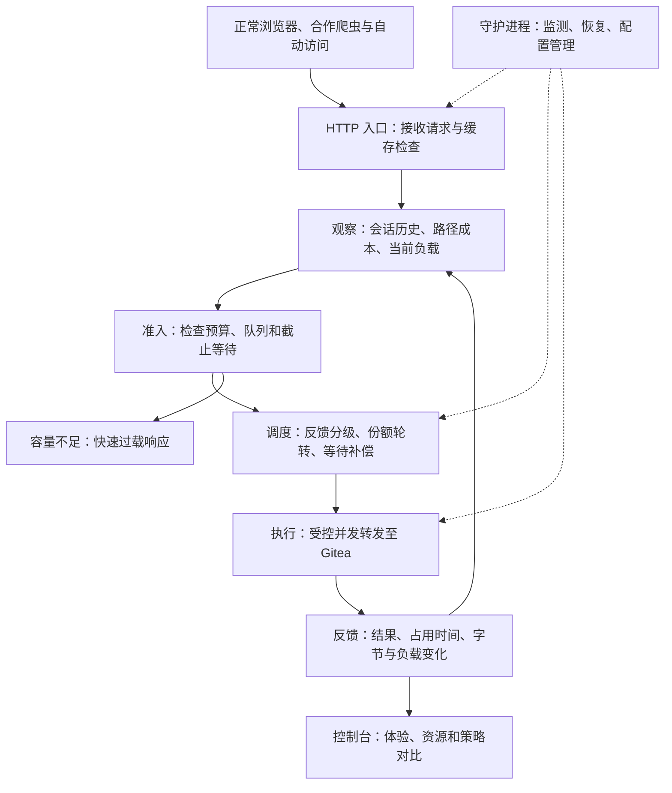

# 护站：面向自动化抓取的小型公共网站访问保障与资源调度系统

> 让公共网站在持续自动访问中保持可用：正常浏览有保障，后台抓取有秩序，空闲资源不浪费。

**文档性质：**OS 课程设计选题与概要方案 v1.0  
**编写日期：**2026-09-28  
**目标读者：**指导教师与项目组  
**主要场景：**小型代码托管站，使用 Gitea 作为真实业务载体  
**当前状态：**设计提案，尚未实现或取得性能结果

## 1. 项目立意：开放内容，也要保障公众使用

### 1.1 一个正在发生的变化

一个小型开源社区把代码、历史版本和文档公开，是为了让开发者查阅、交流和复用。它通常只有有限的服务器预算，也没有专门的运维团队。对于这样的网站，“内容公开”一直意味着任何人都可以访问，但并不意味着它能够无限承担每个访问者带来的计算和带宽成本。

随着自动化内容采集增加，网站的资源分配出现了新的矛盾：机器可以持续遍历仓库、提交历史和文件差异，而真人常常只是进入页面、查看一处代码、阅读一段时间，再继续操作。大量自动访问未必使用异常请求，也未必直接违反每 IP 速率限制，却可能长期占用网站为公众提供服务的处理能力。

当开发者需要查看一次代码差异时，服务器可能正在为一批持续抓取计算历史页面。最终表现为页面迟迟打不开、操作超时、服务错误增加，以及维护者被迫反复处理过载。对小网站而言，这既是性能问题，也是维护开放服务的成本问题。

已有公开记录支持这一背景。[SourceHut 2025 年官方更新](https://sourcehut.org/blog/2025-03-07-whats-cooking-q1-25/)报告 LLM 爬虫造成服务中断和运维负担；[Wikimedia 官方文章](https://diff.wikimedia.org/2025/04/01/how-crawlers-impact-the-operations-of-the-wikimedia-projects/)指出，自 2024 年 1 月起多媒体下载带宽增长 50%，增量主要来自自动抓取。这些案例证明持续抓取可能侵占服务能力，但本项目的具体收益仍需在目标工作负载上测量。

### 1.2 我们要解决的具体问题

本项目研究：**在小型公共网站资源固定、访问者身份判断不完全准确的条件下，如何限制持续高消耗访问对正常浏览的影响，并在资源空闲时继续提供自动访问服务？**

研究目标不是禁止所有爬虫。搜索索引、监控和用户授权的 Agent 都可能有正当用途。系统希望在开放与可用之间建立可执行的服务秩序：轻量交互不被长期挤压，持续抓取不能无限占用，未知访问也有受控的获得服务的机会。

这一目标分为三个彼此关联的结果。

| 目标 | 用户或维护者感受到的变化 | 如何观察 |
| :--- | :--- | :--- |
| 保障正常访问 | 查看仓库、提交和代码差异时，等待更短、超时更少 | 正常会话按时成功率与完成时间 |
| 控制服务器压力 | 自动访问增加时，队列和内存不持续失控 | 源站负载、在途请求与过载持续时间 |
| 保持开放服务 | 有剩余能力时仍完成合理自动访问 | 自动访问成功量、利用率及等待代价 |

“真人无感”作为产品愿景，在实验中转化为明确的响应时限、成功率和误限制指标。调度器不声称知道谁一定是真人，而是对可观察的服务需求和消耗负责，再评估这些安排是否改善真人体验。

### 1.3 场景选择与一次典型使用过程

首版选择一个自托管 Gitea 代码站作为受保护对象。实验仓库包含可复现的代码、提交历史和差异页面。正常用户执行“进入仓库—查看提交—打开差异—阅读代码”的浏览任务；自动访问程序连续遍历部分公开内容，形成不同强度的后台负载。

选择 Gitea 的原因是它具有真实的请求处理过程：访问路径不同、缓存状态不同、仓库历史不同，处理成本也可能不同。这比人为编写一个固定休眠的网页更有说服力。哪些页面确实昂贵，以预实验为准，不预设所有 blame 或 diff 都是重任务。

系统接入后，一次持续抓取会逐渐积累已获服务量；若它同时造成较高资源占用，后续请求会降低获得新执行机会的速度。此时，其他低消耗会话仍能取得服务。夜间或负载下降时，系统允许后台队列使用空闲能力，继续完成抓取。

原先提出的静态网站模板用于建设控制台和演示界面，Gitea 提供真实业务负载；这是本方案明确选择的应用范围。如果最终仍限定为纯静态站，应将主要实验转向缓存后的连接、内存和出口带宽约束，不将 Gitea 的 CPU 结论直接搬过去。

### 1.4 选题价值与现有技术的关系

robots.txt、验证码、商业 Bot Management、限流和反馈式过载保护各有作用。项目不以“现有系统都没有调度”作为立项依据，也不把“使用了 MLFQ”本身称为学术创新。

本课设的价值是，在一个具体、可自托管的小网站场景中，把 **服务量反馈、请求成本、身份不确定性和有界资源** 放进可运行的保护系统，明确展示这些 OS 思想如何改变正常用户体验。算法选择、进程协作和运行结果必须形成可解释的因果链。

---

## 2. 系统方案：把持续争抢变成有秩序的服务

### 2.1 系统的位置与完整服务流程

系统部署在网站入口与 Gitea 之间，作为能够自托管的访问保护网关。TLS 在入口终止或由可信前置代理终止，使系统能够按 HTTP 请求进行决策，避免把一个长连接等同于一个任务。

下面展示请求、状态和反馈如何形成闭环。

网关保护的重点是“是否允许一个请求进入实际处理”。尚未获得执行机会的请求留在有限队列中；若已没有安全的等待空间，则返回适当过载响应。队列不无限增长，也不为每个等待请求占用一个阻塞线程。

### 2.2 四个功能模块及其业务作用

系统以四个模块组织，保持实现和展示边界清楚。

| 模块 | 主要工作 | 直接解决的问题 |
| :--- | :--- | :--- |
| Observer：访问与资源观察 | 维护有限的会话状态，采集到达、完成、并发、请求类别和源站负载 | 知道谁持续占用、哪类操作昂贵、当前是否拥塞 |
| Decision：准入与服务安排 | 根据已获服务、预计成本、等待和负载选择下一批请求 | 防止先到的大量后台请求长期占满执行机会 |
| Executor：受控执行与回收 | 在预算内转发请求，处理超时/断连，归还执行额度 | 让调度决定落实为实际并发控制，避免资源泄漏 |
| Supervisor & Console：运行保障与展示 | 守护恢复、配置版本、日志、实验控制和结果展示 | 使系统能够连续运行、观察和复现实验 |

会话信息优先来自本站有效会话或认证身份。匿名请求只能使用有限可信度的会话标识与来源信息；IP 段和网络指纹作为辅助线索，不直接代表一个真实主体。新身份共享受限的未知访问预算，不能通过不断更换 cookie 或 IP 无限获得高优先级配额。

客户端行为采集不作为首版必须条件。读取操作路径、访问持续性和服务记录已经能够建立可验证的调度原型；更细浏览器信号可在证明有额外价值后再加入。

### 2.3 核心策略：按服务反馈调整机会，而非固定贴人机标签

调度以“可处理的 HTTP 请求”为执行单位，以“会话或受限来源组”为服务计账单位。一个会话的后续请求受它近期获得的服务影响，但不会因为累计使用时间长就永久降级。

策略由四个环节组成，每个环节负责一个不同问题。

1. **先控制总容量。** 设置总在途上限、昂贵端点并发上限及等待队列容量。根据源站排队、处理延迟和资源压力调整允许的在途量，使用平滑和迟滞避免频繁振荡。请求进入后端前预留额度，完成或中止后归还。

2. **按服务反馈分级。** 借鉴 MLFQ，根据一定时间窗口内获得的服务、持续并发和请求成本调整会话的服务等级。持续占用较高的会话降低后续请求的调度权重；消耗较低或经过衰减恢复的会话获得较及时的机会。等级称为交互保障、常规和后台，不直接等同于真人、可疑和机器。

3. **在级内公平分配。** 用成本感知 DRR 类轮转安排同级会话，每轮给予一定服务额度，预计成本不同的请求消耗不同额度。等级间设置受控份额并允许借用空闲能力，避免其他队列闲置时后台任务仍被无谓压制。首版选择 DRR，WFQ 作为对照或扩展，不重复叠加同类算法。

4. **限制等待与饥饿。** 对已接纳请求提供有限等待补偿和后台池最低服务机会，避免持续被插队。补偿不突破全局预算；到达最大等待或队列满时结束等待并返回响应，不承诺超载下所有请求都能完成。

首版把请求成本定义为经测量校准的“服务额度”，可以由端点类别、响应规模和完成后的执行占用估计得到。它是调度估计量，不冒充每请求精确 CPU 时间。CPU 时间、响应字节和墙钟时间分别记录，不直接相加；成本估计误差作为实验变量。

对网页下载，前台用户读完页面后的阅读间隔自然减少其服务消耗；对持续遍历，服务记录能够累积反映其长期需求。这是交互式调度思想在网站上的具体应用，但不会自动证明低消耗者必为真人。

### 2.4 对外行为与可视化体验

普通访问者继续使用原网站，不需要安装插件或在首版中完成计算挑战。通过缓存、适当排队和资源安排减少可见干扰；服务能力不足时，系统明确返回过载状态，避免让所有人长时间等待后一起失败。

控制台以管理员和教师能够直接理解的问题组织，而非首先展示内核字段。

| 视图 | 展示内容 | 要回答的问题 |
| :--- | :--- | :--- |
| 正常访问体验 | 同一浏览任务在不同策略下的完成过程、等待和失败 | 开发者现在能否顺畅查看代码？ |
| 服务分配 | 各队列、会话类别的服务量、等待和借用份额 | 谁获得了资源，为什么这样安排？ |
| 系统健康 | 总负载、在途量、队列长度、状态表、进程状态 | 保护模块是否也在过载，系统能否持续运行？ |
| 30 天对比 | 各策略的按时成功率、过载时长和自动访问完成量 | 一个月下来，改善是否稳定且有代价说明？ |

可视化界面展示“已知实验标签”时明确标注为评估信息，调度器不能读取生成器给出的真人/爬虫答案。真实运行界面展示的是服务类别与行为信号，避免将推断包装成确定身份。

---

## 3. OS 方法成立性与实现边界

### 3.1 为什么这确实是一个操作系统问题

从 OS 角度看，网站拥有有限的执行槽位、CPU、内存和 I/O 能力；请求不断到达，具有不同成本、等待需求和持续性；系统必须决定接纳哪些工作、谁先执行、共享状态怎样一致以及组件失败后如何恢复。这与操作系统管理有限资源和并发任务的目标一致。

内核能够调度 Gitea 线程，但通常不知道某段计算属于哪次用户浏览、某个来源已连续获得多少服务，以及正在排队的请求是否仍值得等待。应用入口恰好具有这些业务信息，因此可以在 OS 资源控制之上进行任务级服务安排。两者分工不同，而非重新实现一套内核调度器。

### 3.2 四类课程机制及明确用途

以下设计覆盖课件强调的进程管理、调度、同步通信、文件处理与守护要求。每项机制都服务于具体功能，而不是为了凑概念而添加。

| OS 机制组 | 项目中的实现 | 为什么成立 |
| :--- | :--- | :--- |
| 调度与资源分配 | MLFQ 思想的反馈分级、DRR 份额分配、有限老化、信号量控制在途请求 | 同时处理响应及时性、长期公平和有限容量 |
| 进程/线程与 IPC | 入口、调度状态管理、统计与执行模块协作；消息队列或 Unix socket 传递事件 | 并发接收请求与执行工作，分离控制和统计开销 |
| 同步、文件与置换 | 锁保护必要共享数据，单点发放服务额度；有限访问表采用 TTL/LRU；日志与配置原子保存 | 防止重复计账、内存持续增长和配置/日志损坏 |
| 守护、信号与恢复 | 独立后台守护进程监测服务进程，处理异常退出、限频重启、优雅停止与状态恢复 | 满足课件守护要求，并在故障下维持可解释的服务恢复 |

调度状态优先由单一拥有者串行更新并通过 IPC 协调多个入口，避免每个 worker 自己维护一份可以重复使用的额度。必要共享快照用锁或版本机制保护；关键额度不能仅靠最终一致的统计决定。

访问表有明确内存上限，记录过期或被淘汰不解除全局与端点限制。日志异步、限量且轮转，避免防护流量越大、日志 I/O 越先压垮服务器。配置写入采用临时文件和原子替换，多个管理者写同一文件时通过文件锁串行化。

### 3.3 cgroup、eBPF 和 TC 的职责

**cgroup 的首要作用是提供固定、可重复的实验资源边界。** 将源站及相关 Git 子进程置于统一资源限制下；负载生成器独立部署或隔离 CPU。保护模块的资源开销单独测量，并同时报告源站与防护模块的总成本。`cpu.max` 限总预算，`cpu.weight` 仅用于真实独立执行进程存在时的相对份额分配。

**eBPF 可用于观测和可选连接级执行。** 它可以提供连接、网络或进程层观测，但不能仅靠五元组统计推导每个 HTTP 请求的 CPU 归属。首版核心调度在 HTTP 入口完成，先证明策略有效，再比较 eBPF 观测是否降低开销或提供更及时的数据。

**TC/HTB 是带宽场景的扩展。** 对大文件下载，可在出口为不同服务类别提供带宽份额和空闲借用；这与 CPU 密集页面分开验证，避免同时改多个控制器后无法归因。

因此，首版不把 TCP 分流当作请求级 CPU 隔离：同一个 Gitea 进程内的 goroutine 不天然属于独立 cgroup，多个代理池也不会自动让后端计算继承其资源组。这条实现边界已通过 Linux 与 Go 官方文档核验，详见[前置评估](web_scheduling_proposal_review.md)。

### 3.4 故障恢复与最小可交付范围

请求分为等待、已分配、执行中和结束等状态。完成事件携带请求标识，重复上报不重复归还额度；入口断连或执行超时后释放相应资源。控制组件恢复时核对仍在途的工作，不能简单把全部额度重置为可用，从而瞬间过量准入。

守护进程对进程退出进行重启，对连续故障退避，记录恢复耗时。网关整体崩溃可能中断部分连接，项目不承诺零中断；对未知是否完成的请求也不盲目重放。首版业务实验限定公开只读浏览，写入请求保持原有认证与正确性语义。

交付分为基础与扩展，避免将所有候选技术同时实现。

| 范围 | 必须形成的结果 | 选择理由 |
| :--- | :--- | :--- |
| 必做业务闭环 | Gitea、入口保护、有限会话状态、准入和反馈调度 | 直接解决核心体验问题 |
| 必做 OS 与可靠性 | 进程协作、同步计账、有限状态/日志、实际守护恢复 | 回应课件要求并保证可运行 |
| 必做实验展示 | 可复现负载、成熟基线、正常体验与 30 天指标面板 | 回应老师看重的宏观改善 |
| 选做扩展 | eBPF 观测、TC/HTB 或检测开销预算，最多优先一项 | 有证据显示必要时再增加复杂度 |

---

## 4. 如何证明价值：创新表达、验收故事与交付计划

### 4.1 项目贡献应怎样表述

本项目不重新发明 MLFQ、DRR 或限流，而是围绕小型代码站构造一个可测量的系统问题：**在不掌握可靠人机身份、服务器能力固定的情况下，已获服务反馈能否让交互访问更及时，同时保持合理自动访问的服务机会？**

贡献集中在三个方面，而不是为每个模块分别命名创新。

1. **从请求数量转向服务消耗的反馈安排。** 对廉价访问和昂贵页面区别计账，依据近期占用调整后续执行机会，检验是否比单纯计数或固定权重更符合代码站负载。

2. **把身份不确定性纳入调度约束。** 新访问共享有限探索/服务空间，行为信号只作受限调整，避免“一次判错就长期拒绝”；测试同 NAT、同指纹和信息缺失时的体验退化。

3. **把体验、开放程度与系统开销同时展示。** 不靠拒绝所有自动请求取得漂亮延迟，也不靠消耗更多硬件取得加速；在统一资源与策略对照下展示完整取舍。

成本限流、公平队列和负载反馈已有成熟先例。上述贡献属于待验证的课程级系统设计与实验问题，是否具备更强学术新颖性需另行论证。答辩重点是问题建模、机制选用和可靠证据，不使用“首次”“彻底”“保证无误伤”等表述。

### 4.2 一个直观的现场验收故事

演示围绕同一个开发者浏览任务，连续展现四个阶段。

1. **平静时段：**正常用户查看代码，自动抓取较少。展示系统额外开销和正常响应，证明保护模块本身没有明显拖慢基础体验。

2. **抓取高峰：**自动访问持续增加，合理无额外调度的对照开始出现积压。用户打开同类页面，展示实际等待和失败；同时观察 CPU、在途量与队列变化。

3. **策略保护：**在配对回放的相同负载下启用候选方案，对照成熟基线。展示正常会话获得服务的变化，以及后台抓取的服务量与代价；不把不同时间、不同负载的两次截图当作公平比较。

4. **恢复与余量利用：**降低负载后，后台自动访问使用空闲能力继续推进；再注入 worker 异常，展示守护恢复、额度一致性与短时服务影响。

这使老师首先看到“人能否正常使用网站”，再看到背后的调度与资源分配。进程、队列和锁的状态作为解释结果的依据，而不是演示的全部内容。

### 4.3 对照、指标与一个月运行评价

无额外保护用来展示问题，主要结论来自与以下三种策略的比较。所有策略使用相同仓库、资源、缓存、协议设置和到达负载。

| 对照策略 | 具体组成 | 比较意义 |
| :--- | :--- | :--- |
| 固定保护 | 调参后的按 key 限速、全局并发、有界队列 | 判断简单工程方案是否已足够 |
| 成本公平保护 | 相同身份信息下的成本 DRR 与负载准入，不使用服务反馈分级 | 判断反馈分级是否具有增量价值 |
| 候选方案 | 成本公平保护＋近期服务反馈＋有限等待补偿 | 测量主机制，并分别关闭分级/补偿进行消融 |

主要指标按四组展示，避免用错误响应抬高总吞吐。

| 指标组 | 内容 | 宏观含义 |
| :--- | :--- | :--- |
| 正常体验 | 所有到达正常会话的按时成功率、P50/P95/P99 完成时间、超时与拒绝 | 用户能否顺利完成浏览任务 |
| 服务能力 | 有效成功业务量、自动访问有效完成量、等待分布 | 相同资源是否支持更多有用工作 |
| 资源与代价 | 总 CPU/内存、过载持续时间、队列/状态上限、防护开销 | 是否减少拥塞，代价是多少 |
| 稳定与公平 | 共用出口/未知会话的表现、后台最大等待、故障恢复和额度异常 | 是否以牺牲特定群体或稳定性换取平均改善 |

30 天仿真由真实测得的端点服务成本、缓存与资源关系校准，包含日常浏览、持续后台采集和少量正常热门事件。先分阶段真实运行校验模型，再在相同事件轨迹上比较整月结果；多随机种子报告波动，并分开呈现常态与高峰，避免月平均掩盖短时失效。

最终月报回答四个完整问题：有多少正常会话按时成功，最慢一批用户等待减少多少，服务器处于过载状态的时间改变多少，以及自动访问获得的有效服务与防护开销如何变化。数字由实验填入，不预设提升百分比。

模拟器的标签来自负载设计，真实样本的标签来自受控参与者，不能由待评估评分器自行生成。network namespace 仅用于网络条件和地址控制，不被当作真实住宅网络或真实浏览器行为的替代证明。

### 4.4 实施安排与最终交付

按课件前期汇报、集中实现和第六周验收的节奏，建议安排四个里程碑。每一步都产生可检查的成果，使项目不会在最后才发现瓶颈或调度收益不存在。

| 阶段 | 主要工作与成果 | 进入下一步的依据 |
| :--- | :--- | :--- |
| 问题与负载验证 | 固定 Gitea 版本与仓库，测基础成本和拥塞，完成需求/用例与资源模型 | 存在与选定控制点相关、可重复的体验下降 |
| 基础可运行系统 | 完成网关、额度与队列、进程通信、日志和守护；实现固定保护基线 | 全流程正确，队列有界，故障后能恢复 |
| 调度与实证 | 实现成本公平与反馈策略，测试误分组、突发和低负载，做消融 | 增量收益及其代价可解释；必要时简化策略 |
| 展示与验收 | 完成控制台、配对实验、30 天月报、分工和答辩材料 | 现场能重现问题、改善和故障恢复 |

团队可按业务/负载、调度/状态、执行/守护、展示/实验四个责任域分工；4–6 人团队可在负载测量或系统验证上双人协作。个人答辩围绕需求理解、自己的模块、OS 因果关系和实验结果展开，并通过版本提交记录支撑贡献。

最终交付包括可运行的自托管保护模块与 Gitea 演示环境、静态模板开发的管理控制台、可复现负载与策略对照、完整月报及课程设计说明。若成本公平基线已经足够，不掩盖这一结果；据此简化系统，也能体现合理选用 OS 算法的能力。

**选题汇报摘要：**

随着自动化抓取增加，小型开源代码站需要用有限服务器同时承担公众浏览与持续采集，容易出现页面等待、超时和运维负担。本项目设计可自托管的访问保障系统，部署在 Gitea 入口，以近期服务消耗和请求成本为依据，结合多级反馈、公平轮转、同步通信和有界准入，保障低强度交互访问，并在空闲时继续服务后台抓取。系统通过独立守护进程、有限状态管理与故障恢复支持持续运行，以可视化界面和 30 天校准仿真，对比成熟限流及公平调度，评价正常会话按时成功率、尾延迟、资源压力与自动访问服务量。

**证据与设计依据：**公开事件见本文第 1 节；技术先例、适用范围与来源见[反爬与 OS 方法调研](web_bot_control_os_research.md)和[方案技术评估](web_scheduling_proposal_review.md)。课程依据为仓库课件第 3–12 页的机制/守护要求，以及第 14–16 页的需求、运行、OS 应用与答辩考核。本方案采用既有研究组织设计，未新增未经核验的效果数据。
