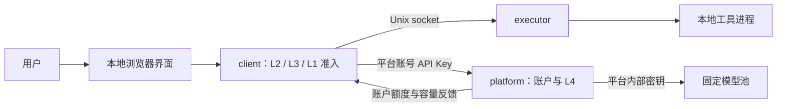

# TaskLoom 基础工程架构

**文档版本** v1.3 · **更新日期** 2026-10-25 · **实现版本** 0.2.0 · **产品方案** [当前完整说明书](../TaskLoom_项目说明书_当前完整方案.md)

本文记录本版 0.2 代码的实际结构，依次说明统一系统模型、模块与进程、协议及账本、执行与恢复。待合并能力、后续算法与实际验证见[当前实现与开发状态](TaskLoom_当前实现与开发状态.md)。

## 1. 系统与运行拓扑

TaskLoom 的个人端和平台端属于同一系统。用户向平台注册账号，个人端使用该账号 Key 调用本平台。平台提供统一模型服务池，账户额度、全局容量和请求队列由平台权威管理。

| 进程 | 所属端 | 职责 |
|---|---|---|
| client。 | 每位用户的个人端。 | 运行轻量 Agent，维护任务与依赖、L1 准入、L3 请求调度，提供本地界面。 |
| executor 与工具子进程。 | 每位用户的个人端。 | 通过私有 Unix socket 接收工作，启动工具、排空输出、取消并核对真实退出。 |
| supervisor。 | 每位用户的个人端。 | 独立启动、监督和重启 client/executor，支持 daemon，使用自己的控制资源。 |
| platform 与 model-pool。 | 统一平台。 | 前者提供账户、L4 与账本；后者表示平台内部固定模型能力。 |

开发启动将 Alice、Bob 两套个人端放在同一 WSL 内，以不同 profile、端口与状态目录模拟两个用户。生产边界允许平台独立主机部署；当前默认监听 loopback，独立部署由 PlatformConfig.listen_host 配置监听地址。

模型池是固定依赖。当前用固定并发槽位和模拟响应时间表征容量，L4 只调度模型服务之前的准入与派发；Linux 调度本地工具进程，模型配置在实验中保持固定。

## 2. 模块与配置所有权

### 2.1 个人端

runtime/agent.py 通过 model、tool、checkpoint 三个端口推进当前已揭示步骤。runtime/registry.py 声明四种受控工具的参数模式，并复用 execution/catalog.py 的资源画像；执行器的处理器覆盖同一目录。client/service.py 管理 Task/Agent/Step/Attempt、输入版本、任务预算、取消代次和成果。client/dispatcher.py 使用原子资源池安排本地工具；client/model_scheduler.py 独立管理模型请求，按根任务执行成本 DRR、期限/老化和在途控制。提升债务跨工具阶段保留，根任务结束且未决执行收敛后回收。

L1 目前按工具画像预留工具名额、内存、产物空间，每次 Attempt 保存版本化 ToolClaim 与完整 ToolRun。恢复时沿用原声明和身份；声明冲突交还对应调用并保留未知占用，调度循环继续运行。adapters/executor.py 记录启动意图、进程身份和结果；adapters/linux.py 设置 cgroup 内存、CPU 和进程数限制。输出读取线程持续排空 stdout/stderr，并限制保留量。

L3 经 FeedbackSource 读取原始观察时间的快照。费用需要量由平台价格计算，Token 窗口按输入加最大输出计算；请求自身暂时不可行时让位给其他可行根任务，账户阻塞与最早期限共同控制等待。关闭 coordinated 仅改变反馈等待，仍使用同一平台。每个 Attempt 保存最初的费用预扣量，首次终态结算才校正公平账本。终态结算同时保存平台创建、派发和完成时间，供实验分离排队等待与服务时间。

ClientConfig 只包含平台 URL、profile 和个人资源/调度配置。实际账号 Key 位于本地 platform-credentials.json，权限为 0600。profile 的 platform_id/account_id 绑定另存账本，不同身份使用独立 profile。

个人端工作台将 Conversation 作为交互容器，同一会话可包含多个独立根任务。每条消息以 TaskCreate.instruction 和输入文件保存，助手结果直接读取任务的校验产物，执行路径读取 Attempt。会话归档只控制后续消息准入，运行中的任务继续执行；取消通过独立任务操作发起。历史无会话任务在启动时原子补建会话记录。旧工具检查点从已保存模型回复建立轮次化逻辑键到原 Step 的别名，保留原 Attempt 和历史请求；升级前快照与升级结果在同一事务保存。

### 2.2 平台端

gateway/accounts.py 管理账号、密码验证、Key 签发和撤销。账户额度由平台注册策略设置；平台保存加盐 PBKDF2 密码验证值和 API Key 摘要，同一账号的多个 Key 共享一份账户额度。

gateway/service.py 运行 L4 调度。SchedulingPolicy 外层选择账号、内层选择根任务，默认 rr，hybrid、drr、maxmin 为候选。派发时同时检查根任务预算、账户与全局的费用/Token 窗口/在途量。平台池容量由 PlatformConfig.pool_capacity 固定。

adapters/provider.py 是平台内部模型服务连接。账户请求 ID 映射为账号隔离的内部身份，再调用固定模型池。模型池还验证内部密钥和容量；个人账号 Key 无法直接调用池。

PlatformConfig 持有模型池 URL、内部密钥、模型名称、总服务容量、注册账户限额，以及模型池价格倍率 output_price、cache_read_price、cache_write_price（以 1 个未缓存输入 token 为 1 个计费单位，默认 1.0，与模拟池按输入加输出 token 计费一致）。PoolConfig 定义模拟池的容量、延迟、模型和内部密钥。

### 2.3 共享工程边界

domain 和 policies 使用标准库；contracts 使用 Pydantic 定义跨边界数据；业务模块依赖端口，adapters 实现协议，bootstrap 显式装配。三项 import-linter 约束执行依赖方向。所有角色由同一个 Python distribution 发布，版本以 pyproject.toml 为准。

## 3. 接口、反馈与持久化

### 3.1 接口分组

| 接口组 | 路由 | 作用 |
|---|---|---|
| 平台账号。 | /v1/accounts/register、login；/v1/account；/v1/account/keys/{id}/revoke。 | 签发、验证、撤销平台账号 Key，读取本人额度和反馈。 |
| 平台请求。 | /v1/roots；/v1/requests；请求查询与 cancel；/v1/models。 | 登记任务归属，接纳、查询和取消模型请求。 |
| 个人端。 | /api/v1/platform；register、login、connect；/api/v1/tasks、graph、cancel、resume、artifacts。 | 配置本平台账号，推进完整任务，查看依赖与交付。 |
| 执行与观测。 | Unix socket 上的 /execute、/attempts；HTTP /health/live、ready、/api/v1/status。 | 管理工具执行，检查进程服务和平台容量。 |

本地优先级由 TaskCreate.priority 保存，`/api/v1/tasks/{id}/priority` 更新仍在等待的工作。模型队列沿用成本 DRR、期限和老化，在同一有界提升预算内接受手动优先级；工具队列按高/普通/低 4:2:1 轮转，各档内部按根任务公平分配。运行中的工作保持原执行，不因修改优先级重启。

客户端 POST 需要 X-TaskLoom-Local: 1，平台账号路由以账号 API Key 鉴权。模型池私钥只在平台内使用。普通账号反馈排除其他用户的任务、凭证和密码。

会话接口为 /api/v1/conversations、/{id}、/{id}/update 和 /{id}/messages，分别用于列表与创建、详情、重命名或归档、提交新任务。会话及根任务关联在同一事务中持久化。/api/v1/resources 另外提供模型名额与逐 Attempt 资源分配；内存数值表示调度预留，文件空间表示实际文件总量。平台反馈显式提供模型池类型和计量单位。

### 3.2 两级额度与反馈

平台全局账本记录总消费、总预留、总在途与窗口用量；每个账号有对应的独立账本。请求派发时同时预留两级额度；结算时按一次实际消费更新两级账本。根任务预算是该账号之下的进一步约束。

费用硬上界按输入 Token 的未缓存、缓存读、缓存写最高单价及最大输出费用计算，账户、全局和根任务按“已消费 + 在途硬上界”保护预算。预计费用单独保存在展示预留中，由近期链、账户及平台历史估计。

Token 窗口在派发时计入输入加最大输出，结束时在原窗口中退回未用部分。请求数窗口记录实际派发次数。结果未知时保留费用与槽位，按原身份核对。

PlatformFeedback 提供平台/账号身份、模型池容量、排队与在途、费用及 Token 窗口、价格、硬预算余量、重试时间及原观察时间。L3 使用 `admission_needs(request)` 与 `account_admission_headroom_units`；公平预扣和实际结算使用相同费用单位。推荐待处理上限为每账号一个排队请求。

当前 Token 统计采用模拟池的确定性合同。真实上游接入需要对齐分词统计、最大输出及计费回执，继续使用固定池容量及同一准入链。

### 3.3 状态与升级

个人端数据库为 clients/<profile>/client.db；平台为 platform/state.db；模拟池为 platform/pool.db。SQLite WAL 与单写入线程保存记录和事务事件。执行器另保存 Attempt 原子 JSON 日志。

0.1 的 gateway/state.db 与 provider/state.db 在首次启动时复制到新平台目录，原文件保留。复制前取得旧拥有者锁，已存在的新账本保持原样。任务输入、成果、执行日志和旧凭证配置保留。平台启动时为旧未决请求恢复硬预算与窗口上界，并在同一事务保存请求、账户及全局占用，之后才恢复派发；重复启动不叠加。客户端保存终态及结算标记时采用同一状态更新边界，迟到旧响应沿用已经确认的结果。

## 4. 执行、取消与扩展

个人端保存取消意图后，停止排队/运行工作；工具资源以真实退出为依据归还，未确认执行保持隔离预留。任务结果、物理停止和费用结算分别记录，旧代次结果只保留相应消费和执行事实。

平台在网络调用前保存 DISPATCH_INTENT。状态未知时保留两级预留并核对原请求，重复传输不产生新的派发。当前模拟池支持按请求查询；fixed-http 连接的核对合同需由相应模型服务提供。

supervisor 自动恢复个人端服务。平台目前通过角色启动和持久恢复工作，平台进程的部署监督由后续运行环境接入。

成本 DRR、期限/老化及平台可配置策略已接入。本分支已整合受控多工具，后续继续接入阶段银行家与子 Agent 工作负载，并基于相同账户反馈协议开展联合消融。实现与回归细节见[两端调度修复说明](TaskLoom_两端调度修复_v1.0.md)。

WP6 从本 profile 收集 TaskState、Attempt、事件与资源快照。运行器在发送前原子保存整轮计划及提交意图，逐项记录明确拒绝、已受理、未知提交和结果质量。校准器把已结算成功任务转换成有序服务阶段，逐模型费用与根任务消费核对；平台排队不作为服务时间重放。容量仿真以事件时间推进各阶段，始终保持同一完整工作流。实验细则见[WP6 复现说明](WP6_实验指标与复现.md)。

本版对应 PR #3 集成分支。工具 Attempt 的旧“名称＋参数”描述可以补齐为完整 ToolRun；已有完整请求和 ToolClaim 则原样沿用。检查点升级只验证工具语义和归属，不改写原执行参数。回执的身份、代次、参数和原请求不一致时保留隔离预留，直到核对完成。集成说明见[WP2 与当前主线衔接](TaskLoom_WP2_主线集成修复_v1.0.md)。
