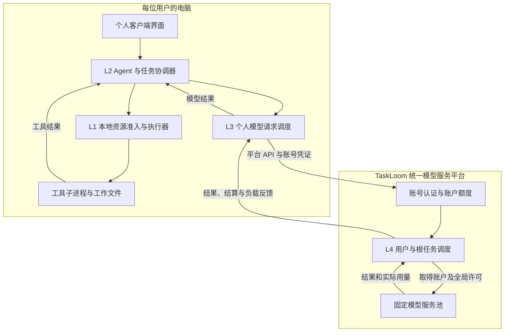

# TaskLoom「织序」项目说明书

> 面向有限本地资源与模型额度的 Agent 多任务调度和平台请求协同系统。

**更新日期** 2026-10-20 · **设计状态** 统一系统完整方案；0.2 基础实现与开发增量分开记录 · **调研依据** 截至 2026-10-14 的归档材料

TaskLoom 是一套由个人客户端和模型服务平台共同组成的系统。用户在平台注册账号，在个人端配置该平台地址与账号 API Key；个人端执行 Agent 和本地工具，平台统一管理账户额度与固定模型服务池。两端共同服务完整任务，在相同设备、模型能力、总服务容量和质量要求下，提高及时且合格完成的任务比例。

本文描述完整研究方案。0.2 已实现账户注册与登录、两端任务闭环、基础轮转、账户/全局额度和反馈等待；当前默认运行使用固定容量模拟模型池和真实 `file_stats` 工具。成本 DRR、阶段银行家、子 Agent 扇出和自适应反馈控制按后续阶段验证。已合并能力、PR 状态和最新工程验证集中见[当前实现与开发状态](engineering/TaskLoom_当前实现与开发状态.md)；第 4 章描述完整技术目标。

本文按四个阶段展开，架构章节先给总体关系，再拆解两端。

| 阶段 | 回答的问题 |
|---|---|
| 1. 痛点发现。 | 问题发生在哪里，根因和证据是什么？ |
| 2. 问题解决。 | 系统改进哪些环节，怎样评价效果？ |
| 3. 架构设计。 | 个人端与平台端怎样组成整体，谁负责什么？ |
| 4. 技术方案与验收。 | 采用哪些 OS 方法，怎样实现和验证？ |

## 1. 痛点发现

### 1.1 使用场景与研究范围

**同一系统同时存在个人任务竞争和平台用户竞争。** 每位用户在自己的电脑上运行客户端，并通过自己的平台账号使用统一模型服务。平台维护固定总服务容量，账户份额与全局容量分别约束。

- **安排个人工作。** 同时整理课程资料、修改并测试代码、提出临时问答；协调本地工具与个人模型请求。
- **接入共享平台。** 多名用户通过统一 API 入口使用共享额度；安排不同用户请求的接纳、等待和派发。
- **固定比较条件。** 保持设备预算、模型能力、额度与成果验收要求一致，测量调度带来的差异。
- **限定实现范围。** 自研轻量 Agent 框架与调度核心，使用受控工具和固定文本模型。

首版按以下边界实施，具体调用与资源需求随执行揭示。

| 方面 | 首版范围 |
|---|---|
| 个人端。 | 实现 L1 本地工具资源、L2 任务推进、L3 个人模型请求管理。 |
| 平台端。 | 实现 L4 多用户请求接纳、调度、共享额度与回传。 |
| 执行环境。 | 使用 Linux 验收；Windows 开发通过 WSL2 进入 Linux 环境。 |
| 调度边界。 | 应用层决定步骤启动与请求派发；Linux 内核调度工具进程，既有服务完成模型推理。 |

### 1.2 个人端的四类痛点

**个人端按资源成本、任务份额、共享访问和生命周期划分问题。** OpenClaw 已有优先级、老化、容量与清理能力，改进在这些成熟机制之后验证。

#### 1.2.1 工具成本不同，数量限制难以控制资源压力

**相同并发数量可能产生不同的内存、CPU 和实例压力。**

- **核对现象。** OpenClaw #161050 报告特定 10 GB VM 上 CLI 子进程、浏览器及重工具的资源压力。[现场记录](https://github.com/openclaw/openclaw/issues/161050)
- **定位根因。** 活跃任务数量只能表达数量；内部线程、内存峰值和工具实例成本需要另外计量。
- **确定切口。** 测量工具画像，采用资源向量准入、信号量和 cgroup；允许可行轻工具先行。
- **评价改善。** 比较工具失败率、整体内存峰值、交互 P95 和按时合格完成率。

#### 1.2.2 派生请求集中，根任务的服务份额难以保持

**多个子 Agent 为同一目标工作，服务份额需要归回原始任务。**

- **核对机制。** 所查 OpenClaw 队列身份用于诊断，子 Agent 并发按发起 Session 等范围计量。[队列类型](https://github.com/openclaw/openclaw/blob/6a64431a10b638958cdeccc782f2b36074274776/src/process/command-queue.types.ts)、[子 Agent](https://github.com/openclaw/openclaw/blob/6a64431a10b638958cdeccc782f2b36074274776/docs/tools/subagents.md)
- **定位根因。** 按调用或分支计量，与按完整任务分配不同；共享 API 的请求数和 token 约束又分别生效。
- **确定切口。** 让分支继承根任务预算，采用成本 DRR（赤字轮转）、老化和统一请求入口。
- **评价改善。** 改变分支数与请求成本，测根任务服务量、交互完成 P95 和后台最长等待。

这是基于现行机制的优化切口，失衡程度与新增收益通过目标负载实测确认。

#### 1.2.3 共享对象重复初始化，访问与所有权可能冲突

**相同资源可能重复创建，共享文件也需要明确访问顺序。**

- **核对现象。** OpenClaw #95506 报告同配置多会话重复建立 MCP 实例；DeepSeek #3590 报告并发初始化及句柄覆盖。[实例记录](https://github.com/openclaw/openclaw/issues/95506)、[竞态记录](https://github.com/deepseek-ai/deepseek-harness/discussions/3590)
- **定位根因。** 缺少初始化互斥会重复创建；按会话隔离虽保护状态，也可能增加重复成本。
- **确定切口。** 首版实现初始化互斥、single-flight（同一初始化仅执行一次）、文件锁与输入版本检查。
- **评价改善。** 测重复实例数、重复处理量、共享访问冲突和成果正确性；完整 MCP 共享池列为扩展。

复用只覆盖权限、配置、输入版本和语义一致的对象；状态隔离要求单独保持。

#### 1.2.4 等待、取消和结束事实衔接不一致

**任务状态、实际资源与消费分别变化，需要可靠交接。**

- **核对机制。** OpenClaw 的 hook 超时会结束等待，handler 仍可能运行；父子让出已有专门机制。[hook 契约](https://github.com/openclaw/openclaw/blob/6a64431a10b638958cdeccc782f2b36074274776/docs/plugins/hooks/reference.md)
- **定位根因。** 迟到授权、旧结果和执行器退出可能改变不同账本；界面结束与物理回收的时点不同。
- **确定切口。** 登记等待原因与尝试代次，使用事件唤醒、幂等确认、真实进程核对和独立守护。
- **评价改善。** 测取消收敛时延、残留资源、迟到结果及恢复成功率；按版本复测原生能力。

### 1.3 平台端的四类痛点

**平台端按服务份额、排队容量、额度一致性和控制响应划分问题。** 现有公平、限流与背压进入基线，研究任务级协调的增量。

#### 1.3.1 请求成本与任务归属不同，服务份额容易偏移

**相同请求数量可以对应不同成本，任务归属也需要额外信息。**

- **核对依据。** API 分别限制请求数与 token；Temporal、LiteLLM 已提供公平或份额机制。[API 合同](https://platform.openai.com/docs/guides/rate-limits)、[成熟公平](https://docs.temporal.io/develop/task-queue-priority-fairness)
- **定位根因。** 单次上下文提供请求内容；根任务、步骤和期限由客户端协议补充，按数量公平与按成本公平不同。
- **确定切口。** 核验用户和根任务，先分用户、再分根任务；按预计成本分配并用实际用量校正。
- **评价改善。** 测不同用户、分支数与请求成本下的服务量和任务完成率，确认哪些条件仍有收益。

该项属于接口事实和策略取舍，具体平台失衡由实测判断。

#### 1.3.2 队首请求暂不可行，积压占用内存与连接

**等待队列和实际派发分别占用资源，需要分别约束。**

- **核对依据。** 下游限速需要同时管理队列与执行并发；Kubernetes APF 将排队、公平席位和准入分开。[下游控制](https://docs.temporal.io/guides/rate-limit-downstream-apis)、[APF](https://kubernetes.io/docs/concepts/cluster-administration/flow-control/)
- **定位根因。** 大请求暂不满足额度时，简单 FIFO 会阻挡可行小请求；只限制在途数仍可能积累排队上下文。
- **确定切口。** 限制队列数量、字节和等待期限，扫描可行候选，并为大请求保留积累机会。
- **评价改善。** 测排队内存、空闲派发机会、尾延迟和拒绝率，将未完成请求保留在统计中。

有界接纳已有成熟方法；首版把它作为基本保障，再比较多约束下的候选选择。

#### 1.3.3 多来源共用额度，预留、恢复和结算容易错位

**共享域需要统一准入，速率、在途与费用采用不同规则。**

- **核对依据。** Temporal 文档说明缺少联合下游限速会造成 429、工作流失败与浪费执行；费用预留还存在安全与利用率取舍。[A25](https://docs.temporal.io/guides/rate-limit-downstream-apis)、[预留设计讨论](https://api.github.com/repos/BerriAI/litellm/pulls/38647)
- **定位根因。** 各来源分别判断额度会遗漏全局占用；重试、断连与迟到结果又改变实际消费。
- **确定切口。** 使用权威账本与原子预留，统一等待提示和尝试身份，分别处理速率恢复与费用结算。
- **评价改善。** 测额度违规、429、无效重试、未结算预留与实际预算使用率。

正确限流和预留属于首版基础；估计偏差及安全预留的效率代价单独评价。

#### 1.3.4 控制请求共享工作通道，状态和取消被慢工作拖住

**状态、取消和健康查询需要及时的控制路径。**

- **核对现象。** OpenClaw #165950 记录 health/status 受请求准备队列阻塞；固定 main 快照仅缓解部分路径。[记录与状态](https://github.com/openclaw/openclaw/issues/165950)
- **定位根因。** 控制 RPC 与耗时准备共享准入或队列，轻查询被前面的慢工作阻挡。
- **确定切口。** 为平台状态和取消设置独立有界通道、保留处理容量，读取快照并异步处理长工作。
- **评价改善。** 在重负载下测控制响应 P95、取消传达时延与普通请求吞吐。

该证据来自 OpenClaw 运行 Gateway，作为本项目多用户 API 网关的控制面设计依据。

### 1.4 课设目标与开发约束

**先交付可运行核心，再验证有价值的增量。** 课件第 3—16 页是原理、守护与验收依据。课件原文（本地留存：`agent-workspace/inputs/course/操作系统原理课程设计(3).pdf`）

- **覆盖 OS 基础。** 实现进程、线程、信号、IPC、同步互斥、文件与文件锁，并提供独立守护进程。
- **完成软件闭环。** 交付两端应用、真实工具、成果验收、恢复和可视化。
- **保留成熟基线。** 启用已有的公平、限流、隔离和清理，比较新增机制的效果。
- **控制开发范围。** 先做受控工具与单实例平台；完整 MCP 共享池、多模型和复杂生态按瓶颈扩展。

---

## 2. 问题解决与系统目标

### 2.1 个人端：围绕根任务协调资源与请求

**个人端以完整目标分配机会，以具体步骤取得执行许可。** 四类痛点与首版能力一一对应。

| 痛点 | 实施能力 | 主要评价 |
|---|---|---|
| 工具资源压力。 | 按画像筛选可行工具，原子预留并保护实际占用。 | 资源失败、内存峰值、交互等待。 |
| 根任务份额偏移。 | 继承任务预算，统一模型入口并实行成本公平。 | 根任务服务量、后台活性、按时率。 |
| 共享对象冲突。 | 串行化初始化，锁定受管访问并校验版本。 | 重复实例、冲突率、成果正确性。 |
| 生命周期错位。 | 区分等待和执行，核对取消、结果和资源回收。 | 回收时延、残留、恢复成功率。 |

个人端相较原版 OpenClaw 的目标，使用相同负载和验收条件判断。

- **改善主指标。** 在预定紧张场景中，使交互 P95、资源失败率或按时合格完成率至少一项稳定改善。
- **保持成果质量。** 使用相同文档、测试和问答验收规则。
- **保护后台活性。** 记录最长等待，允许复杂任务继续推进。
- **守住硬约束。** 遵守资源和预算上限，保留未完成及待核对任务。

### 2.2 平台端：分层公平、统一准入与及时控制

**平台以认证用户分配共享机会，以根任务组织该用户的请求。** 请求接纳、派发和结算分别记录。

| 痛点 | 实施能力 | 主要评价 |
|---|---|---|
| 成本与份额偏移。 | 核验归属，实行用户与根任务分层成本公平。 | 用户份额、短请求等待、完成率。 |
| 队首阻塞与积压。 | 有界接纳，选择可行候选并保护大请求活性。 | 队列内存、尾延迟、拒绝与超时。 |
| 共享额度错位。 | 原子预留，区分速率、在途、费用与重试。 | 额度违规、无效消费、预算利用。 |
| 控制请求迟缓。 | 分离状态和取消通道，保留轻量处理容量。 | 控制 P95、取消传达与总吞吐。 |

- **固定服务条件。** 保持平台模型、总服务容量、总额度和到达负载一致。
- **比较增量收益。** 在合理公平、限流与清理后测任务级协调。
- **提供明确反馈。** 区分容量过载、速率等待、预算耗尽和未知结果。
- **开放结果核对。** 展示队列、在途、消费和服务份额。

### 2.3 首版重点与扩展内容

**按核心、保障、算法验证和增量扩展控制投入。**

| 范围 | 内容 | 交付要求 |
|---|---|---|
| 核心系统。 | 个人 Agent 循环、工具准入、任务公平；L4 共享请求调度。 | 跑通多任务、多用户和真实模型/工具。 |
| 运行保障。 | 初始化互斥、状态、IPC、文件锁、守护与回收。 | 通过并发和故障实验，界面反映真实事实。 |
| 算法验证。 | 原子准入、老化、成本 DRR、受控阶段银行家检查。 | 给出分配、等待、安全检查和对照过程。 |
| 增量扩展。 | 有时效反馈、只读产物复用、OpenClaw 兼容接入。 | 在核心闭环后单独测收益与开销。 |

OpenClaw 承担三种角色，沿用[开发路线](TaskLoom_开发路线与OpenClaw对照方案.md)。

- **提供机制对照。** 保留原生会话、容量、优先级与老化。
- **提供真实产品对照。** 使用固定原版和合理配置比较成果与体验。
- **提供后续接入对象。** 复用 Provider 和插件入口，按实际能力验证覆盖。

---

## 3. 架构设计

### 3.1 总体架构：同一平台账号连接两端

**个人端和平台端属于同一套系统，所有受管模型请求经过本平台。** 用户账号确定平台身份和账户额度；根任务确定个人任务份额、预算及成果归属。

| 边界 | 运行位置 | 管理对象 | 对外关系 |
|---|---|---|---|
| L1：本地资源与工具执行。 | 用户电脑。 | 工具名额、内存、文件、产物与进程组。 | 接收 L2 的工具步骤，返回执行与停止事实。 |
| L2：Agent 任务管理。 | 用户电脑。 | Task、Agent、Step、Attempt、依赖与检查点。 | 向 L1 提交工具，向 L3 提交模型步骤。 |
| L3：个人模型请求调度。 | 用户电脑。 | 本人的请求顺序、任务预算和平台反馈等待。 | 使用平台账号 API Key 请求 L4。 |
| L4：多用户请求调度。 | TaskLoom 平台。 | 用户/根任务队列、账户额度和全局许可。 | 按固定容量向平台内部模型服务派发请求。 |

平台模型池是固定服务能力。开发实验用固定并发槽位与可控响应时间表征总算力池；各对照保持模型池配置一致。研究优化步骤启动、请求顺序、等待和资源交接，模型推理配置保持固定。

完整任务在个人端推进，模型请求在两端衔接。本地工具竞争由 L1 处理；本人的请求竞争由 L3 处理；不同用户对固定模型池的竞争由 L4 处理。

### 3.2 个人端架构：本地执行与平台账号连接

#### 3.2.1 功能模块与职责

**个人端是本机 Agent 应用，浏览器承载当前操作界面，本地进程负责实际工作。**

| 模块组 | 主要实现 | 功能与输出 |
|---|---|---|
| 账号与交互。 | web、bootstrap/apps.py、PlatformHTTP。 | 注册/登录平台注册账号，保存平台 API Key，提交任务并展示平台及本地状态。 |
| L2 任务推进。 | client/service.py、runtime/agent.py。 | 创建工作对象，维护上下文与依赖，保存检查点，取消/续作并验收成果。 |
| L1 工具执行。 | client/dispatcher.py、adapters/executor.py、adapters/linux.py。 | 原子预留工具资源，以 IPC 提交执行，核实退出并回收资源组。 |
| L3 请求管理。 | client/service.py、client/dispatcher.py、PlatformHTTP。 | 根任务轮转、私有预算、个人在途限制，以及依据平台账户反馈控制发送。 |

监督进程和 SQLite 为个人端提供共同支撑。supervisor 在工具预算域外启动、监督和重启 client 与 executor；SQLite 保存状态与事件，工具产物保存在 profile 的任务目录。

个人端配置包含平台地址、profile、本地资源预算和反馈开关。API Key 另存于本机私有凭证文件；模型池地址、内部密钥和全局容量由平台配置持有。

#### 3.2.2 任务对象与身份关系

| 对象 | 表达的内容 | 生命周期责任 |
|---|---|---|
| Task。 | 用户的一项完整目标。 | 管理任务预算、期限、结果和公平份额。 |
| Agent。 | 推进目标的逻辑执行分支。 | 继承根任务和平台账号归属。 |
| Step。 | 已揭示的模型或工具步骤。 | 管理前驱、输入版本与当前尝试。 |
| Attempt。 | 步骤的一次实际执行。 | 核对请求/进程、结果、消费和取消代次。 |

一个平台账号可持有多个 API Key，这些 Key 共用同一账户额度。个人端 profile 固定绑定 platform_id 与 account_id，避免不同账号的任务、输入和预算混用。分支按根任务汇总服务量，消费按具体 Attempt 核对。

#### 3.2.3 两条执行分支

工具分支依次经过 L2、L1 准入和 executor。executor 启动真实进程，在独立 cgroup 中限制 CPU、内存和进程数，并记录 stdout、stderr、退出与产物。

模型分支依次经过 L2、L3 和平台 API。L3 在发送前查询账户额度和排队反馈；等待期间保存步骤状态，以可取消的异步等待让出控制执行。模型结果返回 L2，解锁后续工具或模型步骤。

当前反馈策略保持有限的账户待处理请求，平台持续保留最终准入权。后续在同一入口增加成本 DRR、期限与老化，进一步优化根任务服务份额。

### 3.3 平台端架构：账号、调度与固定模型池

**平台为注册用户提供模型 API，账户约束和总服务容量由平台统一裁决。** L4 负责模型服务之前的请求处理，模型池提供固定的执行能力。

| 模块组 | 主要实现 | 核心功能 |
|---|---|---|
| 账户与凭证。 | gateway/accounts.py。 | 注册、密码验证、签发与撤销 API Key，维护账户预算及速率/并发上限。 |
| L4 准入与调度。 | gateway/service.py、policies/fair.py。 | 有界接纳、用户/根任务两级轮转，原子检查账户及全局许可。 |
| 模型服务连接。 | adapters/provider.py、平台内部 model-pool 进程。 | 由平台私有连接调用固定模型池，解析结果和用量，按请求身份核对。 |
| 账本与反馈。 | adapters/sqlite.py、平台 API。 | 原子保存派发、账户/全局额度、消费和事件，向个人端返回账户与服务状态。 |

#### 3.3.1 账号与账户额度

用户通过平台注册和登录获得账号 API Key。平台根据凭证解析 account_id，客户端提交的任务标识在此身份之下解释。账户 API Key 与模型池内部密钥分别管理。

密码采用加盐 PBKDF2 保存，API Key 在平台保存摘要。平台控制账户预算、窗口请求数、窗口 token 和最大在途量；普通注册请求提供用户名与密码，额度由平台策略分配。

#### 3.3.2 共享服务与请求调度

L4 先按用户、再按用户内部根任务轮转，从当前可行候选中选择请求。派发前，同时检查根任务预算、账户余额、账户在途/速率和平台总预算、总速率、模型池容量。

请求记录、账户预留和全局预留在同一事务中更新。已经记下派发意图后，平台才调用模型池。完成时更新两级账本；结果未知时保留预留并查询原请求。

模型池仅接受平台内部密钥。模拟池再次检查固定容量，记录实际在途和峰值，防止个人账号绕过 L4。不同账号的相同 request_id 映射为不同内部请求身份。

#### 3.3.3 控制与反馈

账户反馈包含平台身份、账户身份、可用模型、账户剩余及预留额度、账户在途与排队、共享池容量与占用、发送建议和观察时间。个人端从这个接口获得协调依据。

状态、取消与健康检查使用轻量 API。当前基础反馈采用排队背压与窗口等待；带有效期的复杂压力模型、反馈平滑和稳定性控制作为后续算法实验。

### 3.4 两端协议与部署

| 协作内容 | 个人端责任 | 平台端责任 |
|---|---|---|
| 账号连接。 | 配置本平台 URL、登录或保存账号 API Key，绑定本机 profile。 | 验证密码/Key，提供账户身份与额度。 |
| 任务请求。 | 登记根任务，发送上下文、Step、Attempt、期限和代次。 | 在认证账号下接纳请求，检查两级额度并安排模型服务。 |
| 执行与结果。 | 管理工具、检查点和成果，按输入版本及代次决定发布。 | 管理模型派发、实际用量、未知状态和幂等结算。 |
| 反馈与部署。 | 保存私有任务与工具产物，根据平台反馈安排发送。 | 保存账户与共享账本；以统一模型池服务多个客户端。 |

开发命令在一台机器上启动平台、固定模型池以及 Alice、Bob 两套隔离个人端，模拟不同用户电脑。实际部署可将平台放到独立主机，个人端配置该平台地址。

个人端的“无反馈”和“反馈协调”是同一链路上的策略开关，模型请求都经本平台。关闭反馈用于贡献消融，账户鉴权、额度检查和固定模型池保持一致。

---

## 4. 技术方案与验收

### 4.1 个人端技术方案

#### 4.1.1 工具资源准入与安全分配

**先选择可行工具，再原子取得资源，最后核验实际归还。**

- **测量画像。** 记录内存、CPU 并行度、实例、产物空间和访问对象；用并发干扰实验校准。[L07](https://arxiv.org/html/2608.24509v1)
- **筛选候选。** 按根任务加权轮转，在份额内结合紧迫程度与年龄选择可行步骤。
- **原子预留。** 将信号量许可与资源账本纳入同一分配协议；不足则等待，启动失败核对回滚。
- **保护实际占用。** 使用进程组及 cgroup v2 的 CPU、内存、进程数量限制，核实后代退出再归还。[C03](https://docs.kernel.org/admin-guide/cgroup-v2.html)

大工具等待过久时，暂缓接纳同类新阶段；已准入阶段完成所需的安全申请继续推进。

以下为准入逻辑示例，受管预算 8 GiB、当前剩余 4 GiB。

| 当前需求 | 处理方式 |
|---|---|
| 1 GiB 的轻工具。 | 当前资源足够，允许先行。 |
| 6 GiB 的重工具。 | 总容量足够，等待当前占用释放。 |
| 10 GiB 的工具。 | 超过总容量，明确拒绝。 |

普通阶段一次申请完整资源；受控分批阶段由 L2 声明、L1 执行银行家检查。

| 检查步骤 | 实施动作 |
|---|---|
| 登记阶段。 | 声明可信 Max、全部受管申请与结束条件；新阶段和上限变化先做安全检查。 |
| 检查边界。 | 检验 Request ≤ Need 与 Request ≤ Available。 |
| 搜索安全序列。 | 试分配后令 Work = Available'，逐次选择 Need ≤ Work 的阶段并加回其 Allocation。 |
| 提交或等待。 | 全部阶段可完成且版本一致才提交，否则登记等待或拒绝越界变更。 |

Max 表示阶段上限，Available 表示当前可用，Allocation 表示已分配，Need = Max − Allocation。检查覆盖可拦截、可归还的实例等资源。[算法依据](TaskLoom_OS算法补充说明.md)

阶段需在声明内独立收敛；等待未声明的子阶段前，结束并释放当前资源阶段。费用和已消耗 token 继续由请求账本管理。

#### 4.1.2 任务推进、等待与唤醒

**L2 依据实际事件推进任务，等待与执行分别占有许可。**

| 状态组 | 进入条件 | 执行规则 |
|---|---|---|
| 就绪。 | 当前依赖和输入版本有效。 | 进入对应资源或请求队列。 |
| 等待。 | 缺资源、额度或子任务结果。 | 保存原因，释放可安全让出的执行许可。 |
| 执行。 | 实际取得许可并启动。 | 登记 Attempt 和真实占用，持续接收事件。 |
| 结束或待核对。 | 获得终态，或执行/消费仍不明。 | 分别核对成果、实际回收和费用。 |

- **登记条件。** 原子衔接检查与等待注册，防止漏掉唤醒。
- **处理事件。** 接收依赖完成、资源释放和额度恢复，重新核验代次与可行性。
- **维持父子关系。** 父任务等待时保存交付关系，子 Agent 使用原根任务份额。
- **保留真实占用。** 继续计量驻留实例、内存和锁，确认结束后归还。

#### 4.1.3 个人模型请求公平与预算

**L3 统一发送入口，公平排序与硬额度分别检查。**

- **汇总请求。** 将所有受控调用归到根任务，子 Agent 继承预算与服务份额。
- **实行成本 DRR。** 逐轮增加信用，按统一成本单位选择请求；高成本请求跨轮积累信用。
- **校正服务量。** 将预计与实际用量差额记入后续信用或欠账，减少持续份额偏移。
- **安排续试。** 结合 Retry-After、指数退避、随机抖动及剩余期限；适配器保持单次派发。

四类约束分别处理，具体计量采用本平台固定服务合同；调研中的服务商限额提供机制参考。[A01](https://platform.openai.com/docs/guides/rate-limits)、[A02](https://docs.anthropic.com/en/api/rate-limits)

| 约束 | 控制规则 | 恢复或结算 |
|---|---|---|
| 请求速率。 | 使用令牌桶或窗口计数。 | 按合同随时间恢复。 |
| 输入输出 token。 | 分别检查合同规定的计量域。 | 根据合同与实际反馈校正。 |
| 在途请求。 | 使用许可和尝试账本。 | 确认对应执行结束后归还。 |
| 费用预算。 | 按可强制上界预留。 | 按实际消费结算，未知项继续保留。 |

L3 管理根任务私有预算和本人的发送顺序，L4 权威管理平台账户额度及全局服务容量。关闭反馈的实验基线仍经过同一平台。已经派发的调用继续原执行，下一请求在派发边界排序。

#### 4.1.4 共享访问、成果与取消交接

**初始化、文件访问、实际停止和成果发布各有明确拥有者。**

| 环节 | 实施规则 | 核对结果 |
|---|---|---|
| 初始化。 | 对相同受控资源使用互斥与 single-flight；失败回滚并通知等待者。 | 避免并发重复创建与句柄覆盖。 |
| 共享文件。 | 按统一锁顺序申请读写许可，核验输入版本，使用临时文件原子发布。 | 保持访问顺序和成果有效性。 |
| 取消回收。 | 持久化取消意图，撤销未启动申请，停止自有进程组并核对后代。 | 确认实际退出后归还资源。 |
| 恢复续作。 | 核对进程、成果和外部状态，再继续可安全重放的步骤。 | 处理旧结果、失效输入和未知尝试。 |

- **限定复用对象。** 只合并权限、配置、版本和语义一致的确定性初始化。
- **释放阶段锁。** 文件操作完成后释放锁，再进入模型或其他长期等待。
- **限制任务规模。** 设置步数、期限、产物空间和消费上限。
- **保存大型输出。** 使用受限文件引用，只向模型和界面传递必要内容。

### 4.2 平台端技术方案：L4 请求处理

#### 4.2.1 身份核验与有界接纳

**L4 接纳前核对所属关系，派发前复检当前许可。**

- **核验归属。** 通过平台注册账号的 API Key 确认用户，登记根任务后关联 Step 与 Attempt。
- **检查输入。** 校验模型、期限、单请求字节及成本声明；兼容调用按用户排队。
- **约束积压。** 设置总队列、单用户队列、总排队字节、等待期限和在途上限。
- **原子复检。** 派发前重新验证旧快照，取得许可后才发送。

反馈按可恢复性区分，方便个人端采取相应动作。

| 原因 | 平台反馈 | 个人端动作 |
|---|---|---|
| 服务容量不足。 | 返回明确过载与等待提示。 | 降低发送，按期限安排续试。 |
| 速率暂时不足。 | 按合同给恢复或等待信息。 | 进入额度等待。 |
| 费用暂被预留。 | 返回待结算状态。 | 等待可确认消费和剩余预算。 |
| 预算耗尽或请求越界。 | 返回明确原因。 | 请求授权调整或结束任务。 |

#### 4.2.2 用户与根任务分层公平

**L4 先分用户份额，再分用户内部的根任务份额。**

- **建立两级队列。** 在认证用户外层、根任务内层分配信用，分支使用原根任务份额。
- **三个口径分开。** 服务份额决定空槽给谁；费用预算和 token 速率窗口是硬上限，按最坏情况准入，结算时退回未用部分。
- **份额候选按占槽计量。** 空槽先给当前占槽最少的一方，占槽相同时近期槽位秒少的优先，允许空闲机会借用、不积累空闲额度。竞争资源是池槽位而不是费用：成本 DRR 实测使长解码挤占他人。默认仍为用户/根任务轮转，全量对照确认后再定。[WP5 实验](engineering/TaskLoom_WP5_L4调度策略设计.md)
- **保护可行工作。** 队首暂不可行时选择其他候选，同时积累大请求所需机会。
- **限制优先超越。** 为紧迫类别设置有边界份额，使用 Aging（老化）保护后台活性。

平台策略核验客户端紧迫声明，最终排序接受资源、期限与额度约束。[Temporal](https://docs.temporal.io/develop/task-queue-priority-fairness)、[APF](https://kubernetes.io/docs/concepts/cluster-administration/flow-control/)

#### 4.2.3 权威账本、尝试与消费结算

**L4 统一管理共享域，速率恢复与消费结算分开执行。**

- **原子预留。** 在短事务内检查请求数、token、在途和费用，预留成功才派发。
- **保存派发事实。** 为实际 HTTP 尝试登记身份、状态和用量，记录迟到结果。
- **核对取消与断连。** 未派发取消撤销预留；已派发且状态不明的尝试进入待核对。
- **结算真实消费。** 使用实际用量或可确认账单，旧尝试的消费继续归入原任务。

| 尝试结果 | 账本处理 |
|---|---|
| 确认未派发。 | 撤销本阶段预留。 |
| 确认执行完成。 | 结算消费，归还已确认释放的许可。 |
| 执行或消费未知。 | 保留对应预留与待核对记录。 |
| 重复提交或迟到返回。 | 按标识和代次核对，幂等结算与发布。 |

模型适配器限制响应缓冲与回传期限，处理普通和流式结果。不可安全重放的外部操作等待核对，避免增加重复消费。

#### 4.2.4 独立控制通道与状态反馈

**状态、取消和健康查询使用轻量控制路径。**

- **分离队列。** 为控制请求设置独立有界通道与保留处理容量。
- **读取快照。** 查询已保存状态，长准备和模型收发异步推进。
- **约束重处理。** 使用有界工作池，避免请求解析或日志积压拖住控制。
- **验证响应。** 在重负载下测状态 P95、取消传达和普通请求吞吐。

基础账户反馈已进入实现，复杂反馈控制按增量实验推进；反馈开关作为单独消融。[控制面依据](https://github.com/openclaw/openclaw/issues/165950)

| 实施档位 | 协作内容 | 规则 |
|---|---|---|
| 当前基础。 | 交换身份、账户额度、结果、派发和池占用状态。 | L3 据此等待与发送，L4 保持最终准入权。 |
| 增量扩展。 | 低频交换窗口建议与相关本地压力。 | 平滑调整，携带有效期，过期采用本端规则。 |

### 4.3 运行保障与 OS 课设对应

#### 4.3.1 独立守护进程与恢复

**守护进程在工具预算域外核对服务和真实后代。**

- **完成守护化。** 在线程启动前执行 fork、setsid，设置目录与权限，关闭继承描述符并重定向标准流。
- **检测故障。** 使用独立日志、健康检测和进程事实确认异常。
- **受控重启。** 采用退避，先核对持久任务、成果和自有进程，再决定回收或续作。
- **展示可靠性。** 注入服务退出和工具超时，核验重启、残留与恢复结果。

#### 4.3.2 线程、IPC 与同步互斥

**进程执行重工具，线程读取和监测，结构化消息交接状态。**

| 使用场景 | 机制 | 实施动作 |
|---|---|---|
| 工具执行。 | 子进程、进程组。 | 启动 CPU 密集工作，记录实际后代。 |
| 输出与监测。 | 有界读取/监测线程、线程安全队列。 | 排空 stdout/stderr，采集资源并追踪关闭。 |
| 本地交接。 | 管道或进程消息队列、互斥与条件变量。 | 交换命令和结果，短临界区内更新许可。 |
| 两端协作。 | 异步 HTTP 与持久事件。 | 传递请求与身份，分别记录各阶段事实。 |

- **分离控制与日志。** 为两类消息设置独立容量和消费路径。
- **缩短临界区。** 将网络等待和长工具执行放在账本锁之外。
- **处理停止信号。** SIGTERM 等只通知退出，主循环完成收敛；带身份的命令由 IPC 确认。
- **防止输出堵塞。** 超过上限时按模板处理并标记，继续排空或完成受控停止。

#### 4.3.3 文件、产物与持久状态

**保存可核对的成果引用，依据拥有者和版本回收文件。**

- **持久保存。** 使用 SQLite 保存任务、尝试、预算和事件，明确写入责任。
- **发布成果。** 创建目录、写临时文件、检查输入版本，再原子发布并登记引用。
- **控制存量。** 限制日志、产物大小和有效期，保留仍被后续步骤引用的成果。
- **恢复核对。** 分别显示成果、进程停止和费用，按事实处理失效或未知尝试。

#### 4.3.4 课程要求与运行证据

**课程验收逐项对应实际机制，运行记录解释 OS 原理的作用。**

| 要求类别 | 对应机制 | 运行证据 |
|---|---|---|
| 进程、信号与守护。 | 工具进程组、cgroup、停止信号、独立守护。 | PID/后代与占用记录、异常退出与重启演示。 |
| 线程、通信与同步。 | 读取线程、管道/消息队列、信号量、条件唤醒。 | 并发、唤醒、重复事件及许可一致性测试。 |
| 文件与资源算法。 | 文件 I/O/锁、持久成果、成本准入、公平与安全检查。 | 冲突实验、恢复记录、分配过程与策略对照。 |
| 分析、设计与交付。 | 需求、UML、思维导图、界面、代码与 API 说明。 | 两端系统、实验分析、分工与个人答辩材料。 |

实施阶段逐项运行验收，同步更新 UML、思维导图和演示材料。

### 4.4 实施、对照与结果评价

#### 4.4.1 开发顺序与团队分工

**先跑通真实闭环，再做个人端优势、平台与联合验证。** 资源画像和原版配置测量前置开展。

| 阶段 | 实施重点 | 完成条件 |
|---|---|---|
| 基础闭环。 | Agent 循环、工具、持久成果、IPC 与守护。 | 单任务能执行、取消、恢复和验收。 |
| 个人端改进。 | 成本准入、根任务公平、共享互斥与回收。 | 给出原版 OpenClaw 对照和适用条件。 |
| 平台与协同。 | L4 公平、共享额度、有界接纳和控制通道。 | 多个隔离客户端真实连接，份额可核对。 |
| 验收展示。 | 界面、消融、故障实验与校准仿真。 | 结果可复查，OS 机制有实际证据。 |

团队按六个工作包协作，指导教师邵文华，组长龚旭。下表为建议人选，实际负责人以 Gitee issue 的认领结果为准；成员邀请与提交约定见 [Gitee 协作说明](engineering/TaskLoom_Gitee协作说明.md)。

| 工作包 | 建议成员 | 责任与认领入口 |
|---|---|---|
| WP1：总体集成。 | 龚旭。 | 公共契约、真实模型后端、装配与集成交付；[工作包 issue](https://gitee.com/Sugaria/TaskLoom/issues/IKM3JP)。 |
| WP2：个人端 Harness。 | 许世浩。 | 自研轻量运行时、多步骤、多工具与子 Agent；配合原版 OpenClaw 对照，兼容接入作为后续扩展；[工作包 issue](https://gitee.com/Sugaria/TaskLoom/issues/IKM3JQ)。 |
| WP3：个人端请求调度。 | 杜金泽。 | L3 成本公平、任务优先级、老化与反馈协调；[工作包 issue](https://gitee.com/Sugaria/TaskLoom/issues/IKM3JR)。 |
| WP4：本地资源与恢复。 | 冀托。 | 工具画像、多资源准入、共享互斥、阶段安全检查与进程回收；[工作包 issue](https://gitee.com/Sugaria/TaskLoom/issues/IKM3JS)。 |
| WP5：平台端调度。 | 方震。 | L4 分层公平、共享额度、有界接纳与平台反馈；[工作包 issue](https://gitee.com/Sugaria/TaskLoom/issues/IKM3JT)。 |
| WP6：实验与可视化。 | 戴淋。 | 真实指标、混合负载、对照实验与校准仿真；[工作包 issue](https://gitee.com/Sugaria/TaskLoom/issues/IKM3JU)。 |

#### 4.4.2 三类对照与贡献消融

**真实产品效果与算法贡献使用不同证据。** 原版 OpenClaw 对照列入个人端首版验收。

| 对照类别 | 保持一致的条件 | 评价用途 |
|---|---|---|
| 真实 OpenClaw。 | 固定版本、任务、工具能力、预算、模型与验收。 | 比较真实成果、资源与等待体验。 |
| OpenClaw 策略复现。 | 共用执行底座，保留会话/容量规则及固定 main 的老化。 | 识别调度粒度与任务协调的贡献。 |
| 成熟方法。 | 启用公平、限流、清理，并使用调好的固定并发。 | 检验新增机制是否仍有收益。 |

- **记录工作量。** 保存两系统的提示、调用次数和自身开销。
- **控制信息。** 使用同一轨迹与逐步揭示依赖，策略获得相同已知信息。
- **切换贡献。** 分别开关个人端、平台端和动态反馈，沿用[五组设计](../research/agent-orchestrate/reports/03_os_design_and_validation.md#43-五组对照与统一验收)。
- **保留保障。** 基础可靠性、必要元数据和硬约束在对照中一致。

#### 4.4.3 负载、指标与月度展示

**以完整任务为主要评价单位，观察两端等待及资源代价。**

- **设置负载。** 覆盖问答、资料和代码任务，预定分支数与用户数变化。
- **划分条件。** 比较宽松、仅工具紧张、仅 API 紧张和双紧张。
- **验收质量。** 检查资料覆盖与索引、代码测试及输入版本，问答按评分表匿名复核。
- **统计全部任务。** 以全部提交任务为分母，未完成或待核对项继续观测或单列删失。

主指标是按时且合格完成的根任务比例，辅助指标按四组汇总。

| 指标组 | 主要指标 |
|---|---|
| 个人体验。 | 提交至有效回答的交互 P95、资源失败率、后台最长等待。 |
| 平台服务。 | 接纳后等待、用户/根任务份额、过载/429 与超时比例。 |
| 资源消费。 | 总内存、CPU、产物空间、实际费用、无效重试与未结算预留。 |
| 可靠结束。 | 取消回收时延、残留、恢复成功率和成果正确性。 |

- **报告波动。** 使用多次同条件配对运行，给出原始值和差异。
- **确认消费。** 费用在结算后补报，持续保留未知项。
- **校准仿真。** 用真实画像与请求轨迹驱动相同 30 天任务到达序列。
- **解释增益。** 展示每月多完成的合格任务、等待下降和失败/无效消费减少；按时率用百分点差。

#### 4.4.4 资料入口与版本依据

**本说明书是当前完整方案入口，研究索引继续由 research 维护。**

- **定位问题。** 查阅[主题报告](../research/agent-orchestrate/reports/01_layered_theme_report.md)、[OpenClaw 专题](../research/agent-orchestrate/reports/02_solutions_and_integration.md)和[OS 设计](../research/agent-orchestrate/reports/03_os_design_and_validation.md)。
- **核对版本。** 使用[OpenClaw 核查记录](../research/agent-orchestrate/materials/_index/openclaw_audit.json)和[开发路线](TaskLoom_开发路线与OpenClaw对照方案.md)。组内接入报告在本地 `agent-workspace/inputs/reports/` 留存。
- **查阅方法。** 参考[OS 算法补充](TaskLoom_OS算法补充说明.md)、[cgroup v2](https://docs.kernel.org/admin-guide/cgroup-v2.html)和[Temporal 公平](https://docs.temporal.io/develop/task-queue-priority-fairness)。
- **准备验收。** 按[当前实现状态](engineering/TaskLoom_当前实现与开发状态.md)、[工作台与指标口径](engineering/TaskLoom_个人端工作台与验收.md)及[工程计划](engineering/TaskLoom_工程骨架搭建计划.md)组织验收；课件保存在本地输入目录，前版图稿与展示材料见[备份索引](../backup/README.md)。
