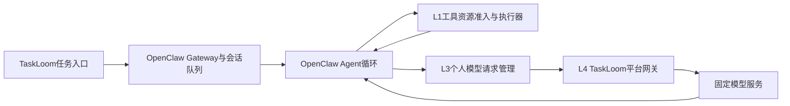

# TaskLoom 现有方案与落地接入评估

> 按四层职责比较已有能力，明确TaskLoom需要复用的底座和能够介入的执行边界。

**整理日期** 2026-10-14　**基础证据** 2026-09-29　**OpenClaw补充** 2026-10-14　**用途** 基线选择、客户端搭建与平台接入。

**正文对齐** 2026-10-20。本轮更新工程路线与引用导航，证据核查日期沿用上述记录；产品功能以[当前实现状态](../../../docs/engineering/TaskLoom_当前实现与开发状态.md)为准，本文中的算法设计按后续实验验证。

本文先按L1–L4比较现有能力，再在第5章集中核查OpenClaw的机制、剩余问题和可选接入。TaskLoom主线为自研轻量运行时，原版OpenClaw用于首版实验对照，兼容接入后续独立开发。基础方案来自原有归档，OpenClaw补充依据2026-10-14取得的版本、源码和问题记录。每个问题的证据状态见[统一主题报告](01_layered_theme_report.md)，来源详情见[来源索引](../materials/_index/source_index.md)。

## 1. L1：复用资源保护，补齐任务级执行管理

操作系统与分布式运行时已经提供资源声明、容量控制、进程组和实例隔离。TaskLoom需要把这些控制绑定到自己的工具步骤、实际后代和产物拥有者。

### 1.1 已有方案能够解决什么

以下方案分别处理准入、物理保护和共享访问，应按实际部署环境选用。

| 方案 | 已有能力 | TaskLoom的使用方式 |
| :--- | :--- | :--- |
| Ray资源声明、并发与pending控制 | 逻辑资源准入、内存相关并发控制、嵌套任务资源处理。 | 借鉴资源声明和有界提交；真实占用另行测量。[C01](https://docs.ray.io/en/latest/ray-core/scheduling/resources.html)、[C09](https://docs.ray.io/en/latest/ray-core/patterns/limit-running-tasks.html)、[C14](https://docs.ray.io/en/latest/ray-core/tasks/nested-tasks.html)。 |
| Linux cgroup v2 | CPU、内存、进程数量等资源保护及组内终止。 | 首版保护自己启动的工具树，并记录实际回收。[C03](https://docs.kernel.org/admin-guide/cgroup-v2.html)。 |
| Windows Job Objects | 进程集合管理、限制与关闭语义。 | Windows执行器的可选实现，按其平台契约验证。[C11](https://learn.microsoft.com/en-us/windows/win32/procthread/job-objects)。 |
| profile、worktree与访问锁 | 隔离浏览器状态、工作区和受控共享访问。 | 优先复用成熟隔离；共享对象仍遵循步骤依赖。[P10](https://github.com/microsoft/playwright-mcp/blob/main/README.md)、[CCD02](https://code.claude.com/docs/en/agent-teams)。 |

### 1.2 接入需要补齐什么

资源执行器必须取得工具需求、访问对象、父任务身份和取消信号，再统一启动工具。对真实内部线程和后代进程计量，保留等待期间仍占用的内存、profile和锁。空间不足或工具超限的结果应明确进入任务状态。

首版可采用Linux执行器、进程组与cgroup v2。工具先限定为能够测量和验收的文件解析、检索、构建或测试程序；用真实程序验证资源竞争，再扩展工具集合。

---

## 2. L2：选择可控制调用边界的Harness

Harness负责Agent循环、模型与工具的实际调用及状态保存。接入的关键是取得执行前控制权、完整任务身份和可靠结束信号，而不是只收集日志。

### 2.1 运行时选择与扩展接口

现有归档支持以下接入判断。框架、SDK与成品Harness承担的职责不同，首版选择一个主要运行时。

| 方案 | 可复用能力 | 介入点与工程要求 |
| :--- | :--- | :--- |
| OpenClaw（机制与原版产品对照） | Gateway、Agent循环、工具、子任务、lane、状态与现成生命周期。 | 工具gate、Provider传输和认证RPC分别接入；原生能力及版本缺口集中在第5章。[OC-D02](https://github.com/openclaw/openclaw/blob/6a64431a10b638958cdeccc782f2b36074274776/docs/concepts/agent-loop.md)、[OC-D18](https://github.com/openclaw/openclaw/blob/6a64431a10b638958cdeccc782f2b36074274776/docs/plugins/hooks/reference.md)、[OC-D21](https://github.com/openclaw/openclaw/blob/6a64431a10b638958cdeccc782f2b36074274776/docs/plugins/sdk-provider-plugins/runtime-hooks.md)。 |
| LangChain与LangGraph | Agent循环、模型和工具中间件、图状态、检查点与恢复。 | 包装调用handler，在实际执行前取得许可；根任务份额和资源账本由TaskLoom维护。[R04](https://docs.langchain.com/oss/python/langchain/middleware/custom)、[A10](https://docs.langchain.com/oss/python/langgraph/durable-execution)、[P24](https://docs.langchain.com/oss/python/langgraph/checkpointers)。 |
| DeepSeek Harness | 插件架构、模型流包装、工具执行包装和子Agent身份。 | 接入`llm/stream`与`tools/execute`，保持流式返回、取消和父子契约；锁定版本。[R06](https://raw.githubusercontent.com/deepseek-ai/deepseek-harness/master/docs/subsystems/llm-streaming.md)、[R07](https://raw.githubusercontent.com/deepseek-ai/deepseek-harness/master/docs/subsystems/tools.md)、[DS_subagent_docs](https://raw.githubusercontent.com/deepseek-ai/deepseek-harness/master/docs/subsystems/subagent.md)。 |
| Claude Agent SDK | 工具前后hook和生命周期事件。 | 用于检查、拒绝及观测；按照hook等待与超时契约接入自有执行层。[R03](https://platform.claude.com/docs/en/agent-sdk/hooks)、[CCD05](https://code.claude.com/docs/en/hooks)。 |
| Codex app-server | turn启动、中断、事件和审批接口。 | 管理公开执行入口，逐项核验工具及模型调用控制范围。[R05](https://developers.openai.com/codex/app-server)。 |

客户端已确定自研轻量运行时，直接管理完整任务、资源许可与请求派发；OpenClaw用于原版产品和策略对照，可选适配路线见第5章。LangChain、LangGraph等保留为接口和恢复方法对照。接口验证时应检查等待许可是否已经占用原生执行槽、后续候选能否继续就绪，以及取消能否同时清除待队记录。这些条件决定能否真正控制准入顺序。

### 2.2 GitHub材料提供的工程启发

原调研深入阅读Codex 12、Claude Code 15、DeepSeek Harness 19个主要问题条目。条目按机制合并后用于定义下面三类工程要求；相关源码和修复记录共同进入比较。

| 产品 | 最有价值的材料 | 接入时应验证的要求 |
| :--- | :--- | :--- |
| Codex | 特定LFS临时副本、MCP结束路径、本地RPC与队列状态。 | 真实资源拥有者、结束交接和控制消息可达。[CX34953](https://github.com/openai/codex/issues/34953)、[CX48524](https://github.com/openai/codex/issues/48524)、[CX38385](https://github.com/openai/codex/issues/38385)。 |
| Claude Code | 额度中断后的成果发现、scheduled占槽、父子停止与hook契约。 | 任务树续作、状态分类和按实际终态对账。[CC03](https://github.com/anthropics/claude-code/issues/94222)、[CC06](https://github.com/anthropics/claude-code/issues/92753)、[CC11](https://github.com/anthropics/claude-code/issues/92716)。 |
| DeepSeek Harness | 重试头传递、并发初始化、消息失败回滚与唤醒。 | 统一错误契约、初始化互斥、回滚和代际唤醒。[D3128](https://github.com/deepseek-ai/deepseek-harness/discussions/3128)、[D3590](https://github.com/deepseek-ai/deepseek-harness/discussions/3590)、[D7936](https://github.com/deepseek-ai/deepseek-harness/discussions/7936)、[D274](https://github.com/deepseek-ai/deepseek-harness/discussions/274)。 |

现成并发、恢复、进程组及租约实现构成强基线。已覆盖的历史问题留作反证与故障模型，具体尚未确认的产品根因留在编码记录中。

### 2.3 如何开始搭建客户端

按真实任务闭环逐步建设，四个阶段各有一个可验收结果。

1. 接通提交任务、调用模型、执行工具、交付结果，建立四种身份及父子映射。

2. 把所有受控调用登记为就绪步骤，在调用前接入工具资源准入和个人请求队列。

3. 加入任务状态持久化、结果索引、取消传播和实际进程回收，核对恢复后的Attempt。

4. 接通平台API网关和观察界面，用真实队列、进程与用量驱动状态展示。

当前0.2客户端通过浏览器提供界面，本地后台服务保存任务账本并驱动执行器。工作台展示真实文件工具和本地资源预留，模型响应与用量由固定模拟池提供；多工具、子Agent与高级调度随工作包扩展，指标口径见[工作台说明](../../../docs/engineering/TaskLoom_个人端工作台与验收.md)。

---

## 3. L3：复用额度控制，统一个人任务的调用

模型请求的限制取决于提供商和账户合同。个人端的共同底座应具备正确限流、预算和重试，再比较根任务感知的额外收益。

### 3.1 已有方案与剩余空间

下表区分接口合同、控制产品和研究系统，避免把不同方案的实验收益直接相加。

| 方案 | 已有能力 | 需要继续验证的部分 |
| :--- | :--- | :--- |
| 提供商API契约 | 请求与token速率、额度作用域、恢复和拒绝规则。 | 固定具体模型与合同，分别实现速率、在途及费用规则。[A01](https://platform.openai.com/docs/guides/rate-limits)、[A02](https://docs.anthropic.com/en/api/rate-limits)。 |
| LiteLLM | 路由、预算、限流、优先份额、重试及部分预留结算。 | 功能路径和许可条件不同，按已启用模式比较；费用预留提案另标发布状态。[A04](https://docs.litellm.ai/docs/routing)、[A13](https://docs.litellm.ai/docs/proxy/dynamic_rate_limit)、[A14](https://docs.litellm.ai/docs/proxy/io_token_rate_limits)、[A21](https://api.github.com/repos/BerriAI/litellm/pulls/38647)。 |
| Portkey与Agent Router | 重试、等待提示、用量和多种额度控制。 | 等待上限和长流计数时机分别核验。[A17](https://docs.portkey.ai/docs/product/ai-gateway/automatic-retries.md)、[A19](https://theagentrouter.ai/docs/capabilities/traffic/usage-based-ratelimiting)。 |
| HiveMind | API准入、预算、优先级、估计成本和DAG相关控制。 | 主体为mock评估，工具和文件控制需补充；合理重试进入全部基线。[A06](https://arxiv.org/html/2604.17111v1)。 |

### 3.2 TaskLoom的个人请求入口

所有受控Agent和工具内模型调用经过同一入口，带上根任务、步骤和Attempt。任务规划、工具结果分析、子Agent决策和最终汇总在当前依赖满足后进入请求队列；确定性工具执行走L1。

个人端可以独立工作，按自身额度派发。通过平台共用上游额度时，L4负责全局最终分配，L3只安排本人的任务次序、发送节奏和私有预算，避免两端各自重复分配同一全局容量。

### 3.3 重试与费用应独立核对

重试遵循明确的服务端提示与总期限，每次尝试使用独立身份。请求速率恢复、在途释放和已消费费用采用不同规则，取消或网络断连产生UNKNOWN时保留在途记录。

预留策略比较报告完整费用账目：已结算消耗、未结算预留和结果未知项。订阅五小时或周额度案例作为相邻合同材料，具体计量使用真实反馈。

---

## 4. L4：建立受控网关，验证多用户与两端协同

平台交付物是接收多个客户端模型请求的应用网关。上游模型及其推理配置固定，实验改变接纳、排队、份额和反馈策略。

### 4.1 成熟平台控制应进入基线

平台已有能力按本项目实际公平单位选择，启用条件和派发口径需要在实验记录中固定。

| 先例 | 提供的能力 | 对TaskLoom的意义 |
| :--- | :--- | :--- |
| Temporal | 工作流、优先级、公平与下游API限速。 | 是完整任务控制的强先例；派发次数公平与请求成本公平分别评价。[A24](https://docs.temporal.io/develop/task-queue-priority-fairness)、[A25](https://docs.temporal.io/guides/rate-limit-downstream-apis)。 |
| LiteLLM | 配额份额、借用和请求优先。 | 可作为合理配置网关的比较依据。[A13](https://docs.litellm.ai/docs/proxy/dynamic_rate_limit)、[A26](https://docs.litellm.ai/docs/scheduler)。 |
| Kubernetes APF | 请求队列、并发席位、公平与借用。 | 提供多用户准入设计的成熟OS思路。[C10](https://kubernetes.io/docs/concepts/cluster-administration/flow-control/)。 |
| Ray有界pending | 限制积压工作，向生产者施加背压。 | 支撑等待容量和派发容量分开管理。[C08](https://docs.ray.io/en/latest/ray-core/patterns/limit-pending-tasks.html)。 |

### 4.2 平台需要什么调度信息

会话历史与持久会话关联已经存在，任务调度信息需要通过受控客户端补充。最小协议分为身份关系、服务目标、工作量声明、状态反馈四组；平台认证身份，限制紧急类别，保存状态有效期。

首次接入先核验根任务和Attempt能够贯通。之后分别增加本地压力摘要与平台发送建议，通过信息消融确定哪些字段值得保留。

### 4.3 两端优化如何比较

个人端拥有本地依赖、工具资源和个人任务信息；平台拥有全体用户、共享额度及总队列信息。已有证据支持这种可见性差异，成熟措施后的实际损失应分段测量。

比较个人端独立优化、平台端独立优化、两端分别优化和两端动态协同，保持模型、质量、资源及基础可靠性一致。平台测试使用多个隔离客户端及用户身份，公平单位与实验部署保持对应。

后续具体算法、分工接口和验收条件集中在[OS设计与验证报告](03_os_design_and_validation.md)。

---

## 5. OpenClaw对照专题：机制、剩余问题与可选接入

**核查日期** 2026-10-14　**稳定版** `v2026.10.3`，发布于2026-10-13　**稳定源码** `59cb44796b0f1f0daa0e37af8b1495abb45d9bc1`　**主分支快照** `6a64431a10b638958cdeccc782f2b36074274776`。

本节为OpenClaw原生机制和可选兼容接入的研究依据。TaskLoom当前独立实现个人端运行时与平台L4；首版实验以固定版本的原版OpenClaw对照真实任务效果。后续兼容接入时，可由OpenClaw承担原生会话和Agent循环，TaskLoom适配器管理根任务、工具许可与模型请求。以下映射和复用建议均针对该接入分支。

本节按系统机制、原生调度、剩余问题、接入方案展开。本轮取得16个问题条目的正文与完整可见评论页，重点阅读机制、反证及版本更新，并追查相关PR和固定源码。核查范围包括静态读取、接口分析和公开记录，产品运行与性能实验由实现阶段完成。问题严重度依对应版本与条件，源码核查与用户运行记录分开编码。检索和访问记录见[专题核查记录](../materials/_index/openclaw_audit.json)，基础版本资料见[OC-M01](https://github.com/openclaw/openclaw/releases/tag/v2026.10.3)。

### 5.1 系统机制：对象、调用链与子任务

#### 5.1.1 OpenClaw中的四种运行对象

OpenClaw的配置身份、对话容器、一次执行和具体调用承担不同职责。TaskLoom应复用已有身份，再映射自己的Task、Step和Attempt。

| 对象 | OpenClaw中的含义 | 与TaskLoom的关系 |
| :--- | :--- | :--- |
| 配置Agent | `agents.entries`中的工作身份，绑定工作区、工具、模型与路由规则。 | 一个配置Agent可以处理多个Task；Agent名称不直接作为公平份额。 |
| Session | 保存对话状态和执行归属的容器，由`sessionKey`和`sessionId`定位。 | 接入首轮为每个根任务建立独立根Session，再关联派生Session。 |
| Run／turn | 一次已接纳的Agent执行，可交替进行多次模型与工具操作。 | `runId`用于运行关联；一个Run可能对应多个Step。 |
| Tool／model call | 具体工具调用或模型请求，具有调用与阶段上下文。 | 每次实际派发登记Attempt，并将重试与所属Step关联。 |

配置Agent是长期工作身份，`sessions_spawn`产生的子Agent是具体任务分支。两者均可拥有会话，使用的runtime决定它是在OpenClaw准备好的循环中运行，还是启动外部CLI进程。当前普通子Agent不能统一按“一子Agent一OS进程”计量。[OC-D03](https://github.com/openclaw/openclaw/blob/6a64431a10b638958cdeccc782f2b36074274776/docs/concepts/agent-runtimes.md)、[OC-D04](https://github.com/openclaw/openclaw/blob/6a64431a10b638958cdeccc782f2b36074274776/docs/concepts/agent.md)、[OC-D05](https://github.com/openclaw/openclaw/blob/6a64431a10b638958cdeccc782f2b36074274776/docs/concepts/multi-agent.md)

#### 5.1.2 从用户输入到模型和工具执行

Gateway接受RPC或渠道输入，建立Run，经过会话lane与共享容量许可后推进Agent循环。模型输出工具调用，运行时执行工具，再将结果送入后续模型决策。任务状态和对话写入由实际拥有者管理。

下图给出TaskLoom需要介入的位置。工具和模型是循环中的两条操作分支。

`agent.wait`默认30秒是等待结果的接口时限，超时后底层Run仍可能运行。运行时的模型attempt预算、cron总期限和工具期限另有拥有者；TaskLoom需要分别记录排队、派发、执行和实际结束。[OC-D01](https://github.com/openclaw/openclaw/blob/6a64431a10b638958cdeccc782f2b36074274776/docs/concepts/architecture.md)、[OC-D02](https://github.com/openclaw/openclaw/blob/6a64431a10b638958cdeccc782f2b36074274776/docs/concepts/agent-loop.md)

#### 5.1.3 子Agent、并发预算与显式让出

普通子Agent的`maxConcurrent`按直接发起它的Session计量，默认8；`maxChildrenPerAgent`另限制每会话活跃子任务，默认5。Swarm collector使用独立组预算，Codex-native子Agent则使用Codex自身调度。独立Session与嵌套发起者的预算归属需要逐条映射到根任务。[OC-D08](https://github.com/openclaw/openclaw/blob/6a64431a10b638958cdeccc782f2b36074274776/docs/tools/subagents.md)、[OC-D09](https://github.com/openclaw/openclaw/blob/6a64431a10b638958cdeccc782f2b36074274776/docs/tools/subagents/nesting.md)、[OC-D12](https://github.com/openclaw/openclaw/blob/6a64431a10b638958cdeccc782f2b36074274776/docs/gateway/config-tools/sessions-and-subagents.md)

OpenClaw已有`sessions_yield`机制：当前请求者执行结束，保留委托任务和孩子结果的交付关系，孩子完成后由registry启动续接turn。这是已有的等待释放与继续机制，TaskLoom优先复用其任务归属和交接协议。任意工具hook内部的等待则需要另行确认原生槽位占用。[OC-D07](https://github.com/openclaw/openclaw/blob/6a64431a10b638958cdeccc782f2b36074274776/docs/concepts/subagent-yield-handoff.md)、[OC-S08](https://github.com/openclaw/openclaw/blob/6a64431a10b638958cdeccc782f2b36074274776/src/agents/embedded-agent-runner/run/lane-controller.ts)

#### 5.1.4 已有持久化、取消与物理清理

OpenClaw对会话写入使用writer claim，当前写入核验执行拥有者，旧Run不能随意提交过期上下文。Gateway `chat.send`输入可以持久保存，排队取消有独立身份；重启前尚未进入执行的输入可能显示为interrupted，需要明确续接。[OC-D02](https://github.com/openclaw/openclaw/blob/6a64431a10b638958cdeccc782f2b36074274776/docs/concepts/agent-loop.md)、[OC-D06](https://github.com/openclaw/openclaw/blob/6a64431a10b638958cdeccc782f2b36074274776/docs/concepts/queue.md)

进程supervisor已经区分根结果结束与后代真正消失，提供`waitForExtinction`、取消和合作式shutdown。TaskLoom复用这些事实，不以界面完成或等待接口返回代替物理资源归还。[OC-S09](https://github.com/openclaw/openclaw/blob/6a64431a10b638958cdeccc782f2b36074274776/src/process/supervisor/supervisor.ts)、[OC-S10](https://github.com/openclaw/openclaw/blob/6a64431a10b638958cdeccc782f2b36074274776/src/agents/bash-process-registry.ts)

### 5.2 原生调度：已具备的能力与四层对应

#### 5.2.1 L1已有隔离与限额，资源成本准入仍有空间

Sandbox支持Docker、SSH等后端，可以配置CPU、内存和进程数量等约束；supervisor及原生reaper已有进程清理。普通并发参数控制活跃Run或子任务数量，工具命令的内部线程、内存需求和独立服务存量还需要另外描述。[OC-D13](https://github.com/openclaw/openclaw/blob/6a64431a10b638958cdeccc782f2b36074274776/docs/gateway/config-agents/sandbox.md)、[OC-D14](https://github.com/openclaw/openclaw/blob/6a64431a10b638958cdeccc782f2b36074274776/docs/gateway/sandboxing/docker-backend.md)、[OC-D23](https://github.com/openclaw/openclaw/blob/6a64431a10b638958cdeccc782f2b36074274776/docs/tools/exec.md)、[OC-S09](https://github.com/openclaw/openclaw/blob/6a64431a10b638958cdeccc782f2b36074274776/src/process/supervisor/supervisor.ts)

MCP已有会话级runtime、租约、idle回收与活跃runtime上限。所查manager的静态runtime以`sessionId`作为key；同工作区和配置的多个Session仍可能持有不同实例。TaskLoom的资源模型要计入这类驻留成本，并对可共享资源另设明确隔离规则。[OC-S11](https://github.com/openclaw/openclaw/blob/6a64431a10b638958cdeccc782f2b36074274776/src/agents/agent-bundle-mcp-runtime.ts)、[OC-S12](https://github.com/openclaw/openclaw/blob/6a64431a10b638958cdeccc782f2b36074274776/src/agents/agent-bundle-mcp-manager.ts)、[OC-I95506](https://github.com/openclaw/openclaw/issues/95506)

#### 5.2.2 L2已有lane、优先级与容量组，版本差异必须固定

Session lane保证同一会话的执行顺序，`main`控制入站turn的共享并发，普通子Agent、cron和background按各自拥有者进入相应lane。共享容量组还提供总预算与保留名额，当前容量组选取会考虑lane可行性和其队首顺序。[OC-D06](https://github.com/openclaw/openclaw/blob/6a64431a10b638958cdeccc782f2b36074274776/docs/concepts/queue.md)、[OC-S01](https://github.com/openclaw/openclaw/blob/6a64431a10b638958cdeccc782f2b36074274776/src/process/command-queue.ts)、[OC-S02](https://github.com/openclaw/openclaw/blob/6a64431a10b638958cdeccc782f2b36074274776/src/process/command-queue.types.ts)、[OC-S03](https://github.com/openclaw/openclaw/blob/6a64431a10b638958cdeccc782f2b36074274776/src/process/command-queue.capacity-groups.ts)

版本对照显示两种明确策略。

| 版本 | 队列策略 | 应采用的实验定位 |
| :--- | :--- | :--- |
| 稳定版v2026.10.3 | 三类严格优先：foreground、normal、background；各类内部FIFO。 | 用于展示已发布版本行为，记录尚未包含的主分支改进。 |
| 本次main快照 | 以单调入队时间和优先窗口比较；前台相对normal最多领先15秒，相对background最多领先30秒。 | 作为TaskLoom强基线，已有老化与跨容量组仲裁一起保留。 |

主分支通过同一比较规则抑制新前台请求持续越过旧后台工作。15/30秒是优先超越窗口，实际等待还受已有积压、容量和正在运行的工作影响。所查queue选项中的`taskIdentity`用于诊断，原生准入主要依据lane容量、类别、时间与顺序；根任务成本份额应在其上单独验证。[OC-S04](https://github.com/openclaw/openclaw/blob/6a64431a10b638958cdeccc782f2b36074274776/src/process/command-queue.state.ts)、[OC-S02](https://github.com/openclaw/openclaw/blob/6a64431a10b638958cdeccc782f2b36074274776/src/process/command-queue.types.ts)、[OC-P167683](https://github.com/openclaw/openclaw/pull/167683)

#### 5.2.3 L3已有模型failover，完整请求治理需要跨调用路径

Agent-turn路径已有凭证失败记录、cooldown与model fallback。插件直接调用`runtime.llm.complete`则使用另一条执行路径；当前源码取得一个prepared模型及凭证、执行一次，然后返回`stopReason`，其失败与轮换规则尚未完全复用Agent-turn机制。[OC-D16](https://github.com/openclaw/openclaw/blob/6a64431a10b638958cdeccc782f2b36074274776/docs/concepts/model-failover.md)、[OC-S13](https://github.com/openclaw/openclaw/blob/6a64431a10b638958cdeccc782f2b36074274776/src/plugins/runtime/runtime-llm.runtime.ts)、[OC-S14](https://github.com/openclaw/openclaw/blob/6a64431a10b638958cdeccc782f2b36074274776/src/agents/simple-completion-execution.ts)、[OC-I152360](https://github.com/openclaw/openclaw/issues/152360)

TaskLoom需要统一登记Agent决策、compaction、插件辅助调用和受控工具内模型调用。性能比较固定模型、认证额度域与必要工作量，通过请求次序、等待和预算管理识别收益。官方retry概念页中的部分策略针对渠道消息发送，模型请求策略依据provider与runner的具体接口核验。[OC-D17](https://github.com/openclaw/openclaw/blob/6a64431a10b638958cdeccc782f2b36074274776/docs/concepts/retry.md)、[OC-D21](https://github.com/openclaw/openclaw/blob/6a64431a10b638958cdeccc782f2b36074274776/docs/plugins/sdk-provider-plugins/runtime-hooks.md)

#### 5.2.4 L4通过Provider接入，模型调用与运行控制分开部署

自定义Provider支持`baseUrl`和兼容API，Provider插件提供`wrapStreamFn`、`createStreamFn`和`resolveTransportTurnState`。这些接口适合将个人端请求转交本地L3服务，再进入TaskLoom L4网关，并携带调度身份。`llm_input`和`model_call_started`是观察接口，请求放行应由真正拥有发送权的传输层执行。[OC-D15](https://github.com/openclaw/openclaw/blob/6a64431a10b638958cdeccc782f2b36074274776/docs/concepts/model-providers/custom-providers.md)、[OC-D18](https://github.com/openclaw/openclaw/blob/6a64431a10b638958cdeccc782f2b36074274776/docs/plugins/hooks/reference.md)、[OC-D21](https://github.com/openclaw/openclaw/blob/6a64431a10b638958cdeccc782f2b36074274776/docs/plugins/sdk-provider-plugins/runtime-hooks.md)

在可选兼容接入中，OpenClaw Gateway管理其原生会话和运行，TaskLoom平台管理多用户共享模型请求。两者通过任务映射和请求协议连接，分别记录个人发送前等待、平台接纳后等待和上游响应时间。

### 5.3 当前问题：具体根因、解决状态与介入价值

#### 5.3.1 L1优先问题：数量合规时的内存压力与服务实例重复

以下两项最直接对应个人端资源分配。它们的现象证据和当前实现依据分别记录。

| 问题与编号 | 根因与现有措施 | 剩余判定及TaskLoom切入 |
| :--- | :--- | :--- |
| [OC-I161050](https://github.com/openclaw/openclaw/issues/161050)：小主机资源压力准入。 | 报告者在10GB VM上运行claude-cli子进程、浏览器及重工具；10月补充显示重build/test也可触发压力。数量cap和单资源组硬保护已存在，成本相异的工作仍可同时获准。 | T／条件性H／E3。用真实内存画像、cgroup余量和资源向量做准入，对spawn与重工具使用统一管理域。 |
| [OC-I95506](https://github.com/openclaw/openclaw/issues/95506)：同配置会话持有多个MCP实例。 | 旧测试8会话产生8个连接和catalog；当前manager静态key仍是sessionId，已有租约和清理。实例重复与会话隔离存在取舍。 | T／M／E2。对只读、可证明兼容的服务研究single-flight与实例池；独占服务使用租约或串行准入。 |

第一项提供具体现场条件，尚需用选定的内置runtime补测成本。第二项的共享规则必须包含工作区、配置、权限和状态语义；单写数据库与浏览器profile先保证拥有者一致，再考虑复用。对应主题为T-L1-01和T-L1-04。

后台PTY突然失去owner的[OC-I65983](https://github.com/openclaw/openclaw/issues/65983)与WAL checkpoint停滞的[OC-I164294](https://github.com/openclaw/openclaw/issues/164294)作为U级诊断线索保留。当前已有合作清理，最新WAL样本也包含Gateway健康的现场；这些问题需要定位具体生命周期或native reader，接入首轮重点仍是可控制的资源准入与拥有者。

#### 5.3.2 L2优先问题：控制请求阻塞与合法等待的状态交接

队列策略、控制面容量和父子等待属于不同机制，应各自验证。

| 问题与编号 | 具体根因 | 当前状态与对应方法 |
| :--- | :--- | :--- |
| [OC-I165950](https://github.com/openclaw/openclaw/issues/165950)：health等控制RPC受慢准备阻塞。 | 稳定版在FIFO队首等待4个preparation名额；main改为扫描可行项，部分独立读可越过同连接阻塞，health/status仍不在该独立读名单。 | P／M／E2。验证同连接与跨连接分别等待，使用有限控制通道容量和资格明确的读请求调度。 |
| [OC-I171366](https://github.com/openclaw/openclaw/issues/171366)：Code Mode合法等孩子时被误判stalled。 | 外层control调用绕过生命周期wrapper，内层工具结束后丢失外层仍在等待的诊断事实。 | 稳定10.3为P；main为D，修复[OC-P171570](https://github.com/openclaw/openclaw/pull/171570)于10月14日合并。复用修复，作为WAIT与RUNNING区分的回归用例。 |
| [OC-I155119](https://github.com/openclaw/openclaw/issues/155119)：结果、settle消息和delivery状态不一致。 | 截断匹配与重复投递包含不同子路径；Windows10.2正复现与Linux12组负复现并存，部分结果路径已有修复。 | U／E3。保存Attempt与结果引用，核对重复消息及确认状态，按所选版本复测。 |

[OC-I161506](https://github.com/openclaw/openclaw/issues/161506)中的`activeAhead`在入队取值，`activeNow`在出队取值。两个时点的数值可以出现在健康队列上。该条保留总期限、排队预算与执行预算的测量需求，完整lane持有根因归U。

旧版followup长等待的[OC-I54488](https://github.com/openclaw/openclaw/issues/54488)以及因不活跃而关闭的[OC-I84647](https://github.com/openclaw/openclaw/issues/84647)同样归入待复测材料。TaskLoom用独立根任务Session表示并行目标，同一任务的补充消息继续遵循原生steer与会话写入规则。

#### 5.3.3 L3优先问题：插件调用与Agent调用的失败规则不一致

[OC-I152360](https://github.com/openclaw/openclaw/issues/152360)的历史9.4环境曾报告535次辅助总结全部失败；本轮确认的是当前direct-provider分支只选择并执行一次prepared凭证，再返回结果。`stopReason`现在可以表达错误，跨profile失败记录与轮换仍由未合并的[OC-P152489](https://github.com/openclaw/openclaw/pull/152489)跟踪。当前判断为P／M／E2。

TaskLoom的切入是建立统一调用身份、错误分类和等待预算。OpenClaw继续拥有Agent循环中的尝试，L3负责允许何时发送和统一计账；代理避免再叠加一套隐藏重试。每个HTTP尝试登记真实在途状态，结果未知时保留身份和费用预留。主题归入T-L3-01与T-L3-03。

#### 5.3.4 集成边界与已覆盖问题

[OC-I164545](https://github.com/openclaw/openclaw/issues/164545)及当前源码说明`api.runtime.gateway.request`只允许bundled或trusted official插件使用。这是现有权限契约，TaskLoom本地插件的会话控制应由独立、认证的Gateway RPC适配器承担。任务拥有者、用户权限和目标会话关系在控制操作前核验。[OC-S15](https://github.com/openclaw/openclaw/blob/6a64431a10b638958cdeccc782f2b36074274776/src/gateway/server-plugins.ts)、[OC-S16](https://github.com/openclaw/openclaw/blob/6a64431a10b638958cdeccc782f2b36074274776/src/gateway/server-plugin-subagent-runtime.ts)、[OC-D22](https://github.com/openclaw/openclaw/blob/6a64431a10b638958cdeccc782f2b36074274776/docs/plugins/sdk-runtime.md)

已有解决必须进入基线。下面三组资料用于避免重复研究，并保留正确的回归目标。

| 已覆盖机制 | 依据 | 基线要求 |
| :--- | :--- | :--- |
| 静态优先、容量组仲裁和有界优先超越。 | [OC-P82765](https://github.com/openclaw/openclaw/pull/82765)、[OC-P122764](https://github.com/openclaw/openclaw/pull/122764)、[OC-P167683](https://github.com/openclaw/openclaw/pull/167683)与两版queue源码。 | main基线保留原生老化；TaskLoom增量研究根任务成本与资源协调。 |
| registry热路径增量写与缓存更新。 | [OC-I116227](https://github.com/openclaw/openclaw/issues/116227)、[OC-P116286](https://github.com/openclaw/openclaw/pull/116286)。 | 原全量重写问题退出未解决排名，测试现行生命周期开销。 |
| 僵尸回收、合法嵌套等待与有期限收尾。 | [OC-I97616](https://github.com/openclaw/openclaw/issues/97616)及reaper源码；[OC-P171570](https://github.com/openclaw/openclaw/pull/171570)、[OC-P170493](https://github.com/openclaw/openclaw/pull/170493)。 | 按发布分支固定修复集合，再测试真实停止、等待分类和最终交付。 |

本轮问题单评论含自动审查机器人；机器人意见用于发现关联来源，正式结论依据原文、实际源码、合并记录及带条件的用户测量。各条完整状态已写入统一来源编码。

### 5.4 TaskLoom接入方案：复用OpenClaw，控制实际派发

#### 5.4.1 接入首轮运行形态与版本

接入首轮采用内置`openclaw`运行时、自定义模型API Provider和一组受控工具。运行时选择配置在Provider或模型的`agentRuntime.id`上；先统一一条实际执行路径，再扩展Codex、ACP和CLI backend。当前main包声明的Node要求为`>=24.16.0 <25 || >=26.1.0`，开发环境按固定源码准备。[OC-D03](https://github.com/openclaw/openclaw/blob/6a64431a10b638958cdeccc782f2b36074274776/docs/concepts/agent-runtimes.md)、[OC-M01](https://github.com/openclaw/openclaw/releases/tag/v2026.10.3)

机制对照采用本次固定main快照作为候选，保留稳定10.3行为作版本对照；版本升级以专项回归决定。TaskLoom适配器使用Node／TypeScript连接Plugin SDK，调度服务可以沿用独立Python进程，通过本地HTTP或IPC交换请求与事件。

#### 5.4.2 三个接入组件

客户端按入口、工具、模型三个组件接入，平台接口由模型组件对接。

| 组件 | 接口与职责 | 需要验证的执行事实 |
| :--- | :--- | :--- |
| 任务与控制适配器 | 根任务创建独立Session；采集子Agent派生和终态；认证RPC执行取消与查询。 | Task与Session、runId、父子关系始终可关联，结果与停止分开确认。 |
| 工具资源适配器 | `before_tool_call`申请L1许可，实际工具使用受控执行器，结束事件推动对账。 | 许可先于实际启动，资源占用来自真实进程与实例，超时取消收敛。 |
| 模型请求适配器 | Provider传输或兼容API本地代理接入L3，并把任务元数据发送到L4。 | 所有选定调用路径有身份与用量，流式返回及取消保持完整。 |

`before_tool_call`是可等待的gate，默认每handler15秒，配置上限600000毫秒；hook超时只结束等待，handler可能继续运行。适配器使用自己的取消和许可状态机，核对PENDING、GRANTED、STARTED与结束事实，避免迟到许可留在账本。[OC-D18](https://github.com/openclaw/openclaw/blob/6a64431a10b638958cdeccc782f2b36074274776/docs/plugins/hooks/reference.md)、[OC-D19](https://github.com/openclaw/openclaw/blob/6a64431a10b638958cdeccc782f2b36074274776/docs/plugins/hooks/tool-policy.md)、[OC-S07](https://github.com/openclaw/openclaw/blob/6a64431a10b638958cdeccc782f2b36074274776/src/agents/agent-tools.before-tool-call.policy.ts)、[OC-S19](https://github.com/openclaw/openclaw/blob/6a64431a10b638958cdeccc782f2b36074274776/src/plugins/hook-before-tool-call-result.ts)

普通工具gate发生在Run已经进入原生lane后。等待L1许可期间，它仍可能占用该Run的原生名额；插件返回字段不能直接转交这个lane所有权。接入首轮测量两层队列和槽位占用，入口限制后台Run并保留交互机会；完整Step暂停与续接需要在原生拥有者处接入，而不是虚假释放账本。[OC-S08](https://github.com/openclaw/openclaw/blob/6a64431a10b638958cdeccc782f2b36074274776/src/agents/embedded-agent-runner/run/lane-controller.ts)、[OC-S02](https://github.com/openclaw/openclaw/blob/6a64431a10b638958cdeccc782f2b36074274776/src/process/command-queue.types.ts)、[OC-D07](https://github.com/openclaw/openclaw/blob/6a64431a10b638958cdeccc782f2b36074274776/docs/concepts/subagent-yield-handoff.md)

Provider的StreamFn需要保持其流式返回契约，在内部异步等待派发许可；`resolveTransportTurnState`提供会话和turn等传输信息。TaskLoom分别映射模型call和HTTP Attempt，复用原生身份并生成缺少的根任务关系与唯一尝试编号。[OC-D21](https://github.com/openclaw/openclaw/blob/6a64431a10b638958cdeccc782f2b36074274776/docs/plugins/sdk-provider-plugins/runtime-hooks.md)

待派发时间、模型idle watchdog和attempt预算需要在接入时共同验证。短等待采用有界派发等待，长期WAIT_QUOTA通过持久任务状态与受控续接处理，避免将本地额度等待伪装为已经运行的上游流。[OC-D02](https://github.com/openclaw/openclaw/blob/6a64431a10b638958cdeccc782f2b36074274776/docs/concepts/agent-loop.md)

#### 5.4.3 兼容接入对应的OS方法

方法按四层问题使用，原生已有的能力在全部对照中保留。

| 层次 | TaskLoom拟增加的机制 | 对应改善 |
| :--- | :--- | :--- |
| L1 | 资源向量准入、信号量、互斥、实例池、真实进程树与产物账本。 | 减少数量合规时的资源拥塞，明确独占实例和回收。 |
| L2 | Task—Step—Attempt映射、条件唤醒、IPC控制通道、幂等结果与续作。 | 使等待原因、结果交付和真实终态可核对。 |
| L3 | 根任务成本DRR、额度窗口、预算预留、统一延迟重试。 | 在共享额度域中安排多个完整任务的请求机会。 |
| L4 | 用户与根任务分层公平、明确背压、有时效的两端反馈。 | 将本地可行工作与平台共享服务机会协调起来。 |

银行家检查用于声明上限可信、申请受控、可归还的工具阶段，由L2声明、L1检查。OpenClaw本身的动态Agent运行不需要被当作一个预知全部未来的银行家进程；原子准入、锁顺序与受控阶段检查按具体资源选择。

#### 5.4.4 兼容接入的验证顺序

开发先完成四个有实际记录的验证点，再扩大工作负载。

1. 接通三项独立根任务和一组子Agent，核验Task、Session、Run、Step与Attempt映射，复用原生取消和结果。

2. 在明确PC或cgroup预算下并行真实解析、构建与轻任务，测资源画像、原生槽位与L1等待，比较数量控制和资源准入。

3. 固定模型与授权额度域，让Agent决策、插件辅助调用和受控工具内调用经过L3，测发送等待、失败分类、真实在途与预算。

4. 接通多个隔离客户端与L4，在B11和B11+FB之间只切换动态反馈，测按时合格完成率、交互P95、后台最长等待和恢复。

接入首轮最值得实现的组合是资源成本准入、完整根任务份额和统一请求账本。原生优先级、老化、持久化与回收提供稳定底座，TaskLoom用同条件实验说明这些新增协调如何改善完整任务交付。
